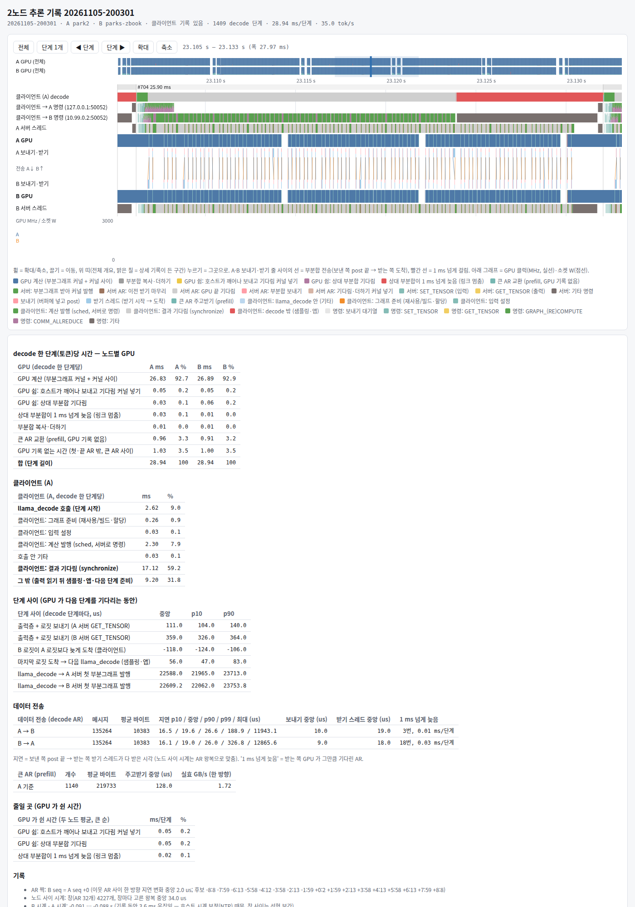

# llm-engine-for-libtbvcoll — 자체 LLM 엔진 (2× HP ZBook Ultra G1a, USB4 RDMA)

Strix Halo(gfx1151) 노트북 두 대를 Thunderbolt/USB4 RDMA(tbv, libtbvcoll)로 묶어 큰 MoE 모델을 돌리는 자체 엔진 작업 저장소.
첫 대상은 Qwen3.8-Flash-Next(qwen4exp). 지금 바탕은 llama.cpp 본선 `e09a78a` + 우리 패치다.

원칙: **다중 노드는 텐서 병렬(TP)만** 쓴다(층 분할·PP 는 중간 단계로도 쓰지 않음). 하드웨어·전원·펌웨어 설정은 바꾸지 않는다(소프트웨어만).
tbv·libtbvcoll 자체는 [zbook-thunderbolt-RDMA](../zbook-thunderbolt-RDMA) 저장소에 있다. 이 저장소의 앞 7개 커밋은 그 저장소 `engine2n/` 의 이력을 그대로 옮긴 것.

## 지금 (2026-11-05, Flash-Next H5, 자세한 값은 RESULTS.md)

2노드 TP 디코드가 올라온 과정. 가중치는 모두 H5, tok/s 는 llama-server 6 프롬프트. 11-03 부터의 변경은 모두 값 그대로(출력이 같음).

| 날짜 | 바뀐 것 | 토큰당 읽는 가중치 GB (노드당) | 2노드 TP | 2노드 TP + MTP | 가중치 읽기로 환산 GB/s (노드당) |
|---|---|---:|---:|---:|---:|
| 10-30 | 우리 비트 배분 H5 | 2.96 | 25.4 | 34.8 | 75 |
| 10-30 | 불러올 때 가중치 합치기(같은 날 끔 24.4 / 34.3) | 2.96 | 25.9 | 36.4 | 77 |
| 10-31 – 11-01 | 라우터 BF16, GDN 상태 캐시에서 바로 읽기, 받는 쪽 zero-copy AR, q8_1 활성값 캐시 등(11-03 아침 기준선) | 2.83 | 27.3 | 38.7 | 77 |
| 11-03 | 작은 연산 묶기·DPP(토큰당 커널 2720 → 1806) | 2.83 | 32.2 | 42.4 | 91 |
| 11-03 – 11-04 | 묶기 셋, 단계 시작 GPU 쉼 줄이기, greedy argmax, AR 링크를 두 번째 케이블로 | 2.83 | 33.6 | — | 95 |
| 11-04 | hc 블록 묶기(11-05 최종 비교의 '끔') | 2.83 | 34.4 | 42.9 | 97 |
| 11-05 새벽 | 값 그대로 커널 묶기 10개 더(A 노드 토큰당 커널 1886 → 1313) | 2.83 | 36.3 | 43.8 | 103 |
| **11-05 오후** | **서버 쪽 argmax — 로짓 대신 (최댓값, 번호)만 받음(같은 날 끔 35.4 / 44.2)** | **2.83** | **36.5** | **45.5** | **103** |

- 토큰당 읽는 가중치: 디코드 1단계에 노드 하나가 읽는 가중치(`tools/bytes_per_token.py 512 10 loaded tp=2`). 나뉘는 텐서(attention·GDN 투영, 전문가 활성분, 출력층)는 절반,
  두 노드에 복제되는 텐서(hyper-connection 0.61, shared expert + 라우터 0.29, indexer 등)는 전부. KV 캐시·GDN 상태·임베딩 조회는 뺐다.
  11-01 부터 라우터를 BF16 으로 읽어 2.96 → 2.83(1노드 전체 4.82 → 4.69). MTP 는 한 단계에 여러 토큰을 검증해 이 값이 생성 토큰당 양은 아니다.
- 환산 GB/s = 노드당 GB × tok/s(MTP 없음). 큰 행렬곱 하나가 내는 ≈220 GB/s 의 절반에 못 미친다: 가중치만 읽는 시간은 토큰당 ≈12.6 ms(225 GB/s 기준)이고
  27.6 ms 중 나머지 ≈15 ms 가 작은 커널·커널 사이 빈틈·AR·토큰 경계.
- tok/s 는 날마다 노드 상태가 달라 ±2% 흔들린다(11-05 오후 기준선 35.4 는 새벽 36.3 보다 낮음). 같은 날 끔/켬 비교는 RESULTS.md 각 절.
- 고정비 분해(2026-10-30, RESULTS.md): 직렬 토큰 ≈52 ms = 가중치 읽기 ≈21 + 행렬곱이 대역폭보다 느린 몫 ≈16(hc ≈7) + 작은 연산 ≈14 + 호스트 0.3.
  토큰당 커널 ≈3200개 × ≈3 µs 발행 바닥.
- 가중치 합치기(2026-10-30, RESULTS.md): 입력이 같은 가중치 168쌍(hc down+inject, GDN qkv+gate, beta+alpha)을 불러올 때 한 텐서로 합쳐
  토큰당 커널 3201 → 2865, 1노드 직렬 −7%. TP 분할 규칙까지 넣어 2노드 TP 끔 대비 +9.5%(MTP 없음)·+9.2%(MTP, 36.6 tok/s).
  다음: 남은 같은 입력 묶음, 활성값 양자화 공유. 2노드에서는 B 가 펌웨어 CPU 우선 상태(GPU 1.7–2.2 GHz)로 남는 것이 병목.
- 작은 연산 묶기·DPP(2026-11-03, RESULTS.md): 토큰당 커널 2720 → 1806, 값 그대로. 2노드 H5(hot 폴링 끔) 디코드 27.3 → **32.2**, MTP 38.7 → **42.4**(41.5–43.3) tok/s.
  2노드에서도 커널 하나가 ≈3–4 µs 라 커널 수가 곧 시간(빈 커널 측정).
- 관측기로 다시 비교(2026-11-04 밤, RESULTS.md): async(지금 구조) 끝까지 + sync(스트림 안 AR + CPU 프록시) 적용. 채택은 greedy argmax 샘플링과
  AR 링크를 두 번째 케이블로(`GGML_RPC_COMM_DEV=usb4_rdma0`) — 2노드 디코드 32.70 → **33.60** tok/s, 값 그대로.
  스트림 안 AR(ZC=3)은 gfx1151 에서 깊은 큐의 커널이 하나하나 느려져 −1–2%. 그래프를 다시 짓는 디코드 단계(≈120 ms, 디코드의 3.5%)가 남은 큰 몫.
- 값 그대로 커널 묶기(2026-11-04 오후 – 11-05 새벽, RESULTS.md): 32워프 블록이 한 행렬의 연속 32행을 맡고 워프 하나가 RDNA mmvq 와 같은 루프·워프 합으로
  한 행을 계산해 비트가 같다. hc 블록(+1.5–2%) 뒤에 묶기 10개: GLU → q8_1, shared expert down + 게이트 꼬리, GDN beta/alpha + gates(+2%), GDN conv + q/k norm,
  AR 기다림-더하기를 처음 읽는 커널 안에서(+1.4%), conv 상태 concat, GDN gated norm, 어텐션 게이트 + q8, q/k norm + rope, indexer key 사슬 12 → 1(+1.1%).
  같은 빌드 끔 → 켬: none 34.4 → **36.3**(+5.4%), MTP 42.9 → **43.8**(+1.9%, 묶기 대부분이 1토큰 그래프 전용). MoE down + 가중합은 두 번 모두 비트 같지만 느려 뺌.
- 토큰 시간 영수증(2026-11-05, 35.4 tok/s 회): 단계 29.7 ms 중 GPU 계산 27.0 ms(91%), 토큰 경계 ≈1.5 ms(출력층 1.15 ms — 노드당 0.26 GB 를 ≈227 GB/s).
- 서버 쪽 argmax(2026-11-05 오후, RESULTS.md): 클라이언트가 토큰마다 두 노드의 로짓 절반(노드당 ≈0.5 MB)을 차례로 받던 것을, 각 노드가 자기 조각에서
  (최댓값, 번호)만 돌려주고 클라이언트가 고르게 바꿈(새 RPC 명령, 값 같음). 로짓은 누가 실제로 물을 때만 받는다. 같은 날 끔 → 켬 none 35.4 → **36.5**,
  MTP 44.2 → **45.5**(둘 다 +3.1%). 다음 후보: MTP 검증 그래프 묶기, llama_decode → 첫 부분그래프 발행(≈0.5 ms).
- MTP(2026-11-05 저녁, RESULTS.md): 한 주기 ≈57 ms 에 ≈2.6 토큰 = 4토큰 검증(2노드) ≈45 ms + 초안 3번(A GPU) ≈11.5 ms. 초안을 2노드로, AR 을 두 번째
  케이블로, 초안 길이 2·3 은 모두 차이 없음. `--spec-draft-p-min` 은 검증 묶음 크기가 바뀔 때마다 그래프를 새로 보내 크게 느려짐(0.3 −23%, 0.5 −41%).

## 시각 자료 — 추론 감시 보고서(inferwatch)

`tools/watch/inferwatch.sh start` 를 켜 두면 실행마다 두 서버·클라이언트의 기록 링을 모아 `runs/watch/<시각>/report.html`(타임라인 + 영수증 표)과
`receipt.md` 를 만든다(Rust, `tools/watch/`). 대표 세 개를 `docs/watch/` 에 둔다 — HTML 은 받아서 브라우저로 연다(각 ≈11 MB, 그래프 데이터 포함).

| 보고서 | 상황 | 디코드 tok/s (서버 측정) |
|---|---|---:|
| [none, 묶기 10개 뒤](docs/watch/20261105-0217-none-fusions.html) · [영수증](docs/watch/20261105-0217-none-fusions-receipt.md) · [그림](docs/watch/20261105-0217-none-fusions.png) | 11-05 02:17, 1토큰 디코드 | 35.4 |
| [none, 서버 쪽 argmax 뒤](docs/watch/20261105-2003-none-argmax.html) · [영수증](docs/watch/20261105-2003-none-argmax-receipt.md) · [그림](docs/watch/20261105-2003-none-argmax.png) | 11-05 20:03, 지금 기본 | 36.45 |
| [MTP](docs/watch/20261105-1702-mtp.html) · [영수증](docs/watch/20261105-1702-mtp-receipt.md) · [그림](docs/watch/20261105-1702-mtp.png) | 11-05 17:02, 초안 3 | 45.85 |



- 위 타임라인: 클라이언트 decode 단계, 클라이언트 → A·B 명령, 두 서버 스레드, 두 GPU, 노드 사이 부분합 전송(선, 빨강 = 1 ms 넘게 걸림), GPU 클럭·소켓 전력.
  휠 = 확대/축소, 끌기 = 이동, 단계 버튼 = 한 단계씩. 아래: 단계당 시간 영수증(GPU 계산·쉼, 클라이언트 몫), 단계 사이, AR 전송 지연, GPU 가 쉰 곳.
- 주의: MTP 는 초안 단계(A GPU 만)와 검증 단계가 섞여 평균이 나온다(나누기는 `tools/bench/mtpcycle.py`). 서버 쪽 argmax 뒤로는 llama_decode 가 로짓을
  기다리지 않고 돌아와 "단계 사이" 표의 llama_decode → 첫 부분그래프 줄이 어긋난다(도구 고칠 거리). 그림은 헤드리스 Chrome 으로 찍은 첫 화면.

## 양자화 구성 비교 (2026-10-30 엔진)

엔진 개선 전에 잰 구성별 값. 그 뒤 엔진 개선은 H5 로만 쟀다(위 표).

| 구성 | 토큰당 읽는 가중치 GB (1노드 전체 / 2노드 노드당) | PPL | 1노드 직렬 | 1노드 + MTP | 2노드 TP | 2노드 TP + MTP |
|---|---:|---:|---:|---:|---:|---:|
| Q8_0 (원본 기준) | 7.30 / 4.28 | 2.0660 | 한 대에 안 들어감 | — | 20.9 | **31.3** |
| unsloth UD-IQ4_XS | 5.84 / 3.56 | 2.1682 | 17.5–17.8 | 31.1–31.3 | 22.6–23.3 | 34.3–34.5 |
| **H5** (우리 배분, Q8_0 에서) | 4.82 / 2.96 | **2.1359** | 18.5 | 31.2 | **25.4** | **34.8** |
| H (halogen 식 밀집 4-bit) | 4.40 / 2.73 | 2.1477 | 19.9 | 32.6 | 25.3 | 34.1 |
| **H5 + 불러올 때 가중치 합치기** (같은 날 같은 조건 끔 → 켬) | 4.82 / 2.96 | 2.1179 | (llama-bench 19.5 → 21.0, 그래프 끔 21.8) | 32.6 → **33.4** | 24.4 → **25.9** | 34.3 → **36.4** |
| (참고) halogen 자체 체크포인트, 개발사 측정 | — | — | 35.4 | 55–57 | — | — |

- tok/s, llama-server 6 프롬프트. 1노드 값은 A 의 '느린 상태'(TB 활동 없음, 빠른 상태에서는 ≈+20%). 2노드는 B rank 0, 발행 겹치기 2, 서버 HIP 그래프 끔, FFN 320/320.
- 토큰당 읽는 가중치는 이때 엔진(라우터 F32) 기준 `tools/bytes_per_token.py 512 10 [tp=2]`. 합치기는 H5 에서 바이트가 거의 안 바뀐다(hc inject 만 Q8_0 → Q6_K).
  Q8_0 은 노드당 읽는 양이 H5 의 1.45배인데 2노드 디코드는 18% 만 느림 — 2노드는 가중치보다 고정비에 묶여 있었다.
- 비트 배분(`tools/make_mix.py`, `quant/`): 전문가 IQ4_XS(down IQ4_NL), o_proj Q8_0, hyper-connection Q6_K/Q8_0, 몸통 4-bit(H) 또는 Q5_0(H5), imatrix.
  gfx1151 에서 IQ3_S 는 4-bit 보다 빠르지 않고 K 형식은 묶음 4 에서 1.7배 느려서(커널 표) 고른 형식.
- MTP 를 켜면 배분과 상관없이 속도가 같다 → 남은 차이는 엔진 고정비(토큰당 ≈19–28 ms).

- 설계: [DESIGN.md](DESIGN.md) (v1, TP). 폐기된 층 분할(PP) 설계는 [DESIGN_v0_pp.md](DESIGN_v0_pp.md), `run_2node.sh` 에 기록용으로만 남김.
- 측정 기록: [RESULTS.md](RESULTS.md)
- 노드 점검 도구(읽기만): [tools/probe/](tools/probe/) — `gpumetrics.py`(gpu_metrics v3.0 클럭·전력·DRAM 카운터), `clkmon2.sh`, `nodeinfo.sh`,
  HIP 시험 `lat.hip`(발행·동기화 지연), `bw.hip`(메모리 대역폭), `wv.hip`(`hipStreamWaitValue32` 동작),
  `kfloor.hip`(작은 커널 하나의 바닥 비용, 그래프/직접), `bigbuf.hip`(큰 버퍼 안 창 읽기 대역폭). 빌드: `hipcc -O2 --offload-arch=gfx1151 x.hip -o x`
  `ktok.py`(rocprofv3 기록 → 토큰당 커널 수·시간), `memclk_ts.py`(FCLK·UCLK·DRAM 카운터 시계열)
- llama.cpp 패치: [patches/llama-e09a78a-engine2n-t5.patch](patches/llama-e09a78a-engine2n-t5.patch)
  - RDMA 전송: 보내기 묶음(flush 때 SEND 1번)·받기 바이트 스트림, 송신 슬롯 링(`GGML_RDMA_TX_SLOTS`), 조각 크기·수신 깊이(`GGML_RDMA_CHUNK`, `GGML_RDMA_RX_DEPTH`)
  - 서버 all-reduce: pinned 호스트 버퍼 + 비동기 복사, 양쪽 동시 조각 교환(`GGML_RPC_COMM_SYM_MAX`, `GGML_RPC_COMM_AHEAD`)
  - AR 뒤 발행 겹치기: `GGML_RPC_COMM_OVERLAP=1|2` — 스트림이 pinned 플래그를 기다리게 하고(ggml-cuda `ggml_backend_stream_wait_u32`,
    `hipStreamWaitValue32`) 다음 부분그래프를 먼저 발행, 2 는 도우미 스레드가 상대 부분합을 받는 즉시 플래그를 쓴다
  - 계측: `GGML_RPC_COMM_PROF=N` (AR 단계별·명령별 시간)
  - AR 호출별 기록: `GGML_RPC_COMM_PROF_TRACE=<file>` (`run_tp.sh` 에서 `TRACE=1`)
  - TP 분할(클라이언트): `LLAMA_TP_FFN_GRAN` (FFN 알갱이, 스크립트 기본 32 → 전문가 640 을 320/320), `LLAMA_TP_FFN_SPLIT` (FFN 만 장치 0 몫),
    `LLAMA_TP_SPLIT_DEBUG=1` (0–3층 분할 출력)
  - `run_tp.sh`: `SRV_ENV` 로 두 서버에 환경변수 전달(기본 `GGML_CUDA_DISABLE_GRAPHS=1`), `APREFIX` 로 A 서버를 rocprofv3 아래에서 실행
  - `GGML_RPC_COMM_OVERLAP=3`: AR 이 GPU 를 기다리지 않고 돌아가고 송수신은 별도 스레드(`hipStreamWriteValue32` 플래그). 정확하지만 이 APU 에서는
    펌웨어가 CPU 우선으로 바뀌어 GPU 클럭이 떨어져 느림 → 기본은 2(`run_tp.sh`)
  - `GGML_RPC_SPIN_US=<n>`: 대기가 n µs 만 바쁘게 돌고 잠듦(RDMA 완료 이벤트, 명령 전달 큐, 송수신 스레드). 미설정이면 기존 동작
  - `GGML_RPC_COMM_BF16_MIN=<n>`: 이 원소 수 이상인 부분합을 bf16 으로 보냄(기본 32768, 아주 크게 주면 모두 f32). 측정용
  - `GGML_RPC_COMM_RAIL2=<RDMA 장치>` (+`GGML_RPC_COMM_RAIL2_MIN`): 두 번째 케이블로 큰 부분합을 반씩 교환. 지금 tbv 에서는 이득 없음, 기본 꺼짐
  - 불러올 때 가중치 합치기(qwen4exp, 기본 켬): `LLAMA_MERGE_WEIGHTS=<mask>` — 1 hc down+inject, 2 GDN qkv+gate, 4 GDN beta+alpha(기본 7, 0 은 끔).
    형식이 다르면 바이트가 큰 쪽 형식으로 다시 양자화(H5 의 hc inject Q8_0 → Q6_K), `LLAMA_MERGE_WIDE=1` 은 bpw 큰 쪽(hc down → Q8_0). TP 에서도 모두 합친다(`attn_qkv_gate`·`ssm_beta_alpha` 분할 규칙 추가, 2026-10-31)
  - `GGML_CUDA_SKIP_OPS=<연산|w:가중치이름,...>` (앞에 `!` 면 나열한 것만 남김): 측정 전용, 결과가 틀림. 연산 종류를 GPU 에서 빼 토큰당 시간이 얼마나 주는지 잰다
    (`fixcost/ablate.sh <GGUF> <회차> 이름=환경 ...`, 프로파일러 없이 고정비 분해)
  - 2026-10-31 – 11-01 엔진 변경(자세한 수치는 RESULTS.md):
    - GDN 상태를 캐시에서 바로 읽기(기본 켬, 값 같음): `GGML_CUDA_NO_GDN_DIRECT=1` 이면 끔
    - 라우터 BF16 사본(기본 켬, 값 같음 — 16-bit 라우터는 F32 정밀도로 계산): `LLAMA_ROUTER_BF16=0` 이면 F32
    - 4토큰 conv `concat` 원소당 스레드 커널(항상)
    - hc 경계 묶기 `GGML_CUDA_HC_MIX=1|f32` (기본 끔 — f32 활성값은 품질 손해), 호스트 검사 `GGML_CUDA_HC_MIX_CHECK=<n>`
    - 받는 쪽 zero-copy AR `GGML_RPC_COMM_ZC` (기본 1, 값 같음): 커널이 coherent 호스트 플래그를 기다렸다 상대 부분합을 더한다. 2 는 보내는 쪽도
      (APU 펌웨어가 CPU 우선으로 바뀌어 느림), 0 은 끔
    - 계측: `GGML_RPC_COMM_PROF` 에 받기 대기·보내기 쪼개기 줄, `GGML_RPC_COMM_PROF_TL=<file>` AR 별 시각(`fixcost/zc-allreduce-1101/tlsum.py`)
    - 양쪽 연속인 2D 복사를 1D 로(HIP 은 4의 배수가 아닌 폭의 2D 복사를 행마다 함 — TP 분할 비율 0.45 로딩 실패의 원인)
    - 바쁜 대기 줄이기 `GGML_CUDA_BLOCKING_SYNC=1`(기본 끔), 디버그 `GGML_CUDA_DUMP_NODES=<n>`
  - 2026-11-03 엔진 변경(모두 기본 켬, 값 같음; 끄는 환경변수):
    - 묶기: hc lo SCALE→SILU 가 q8_1 사본도 `GGML_CUDA_NO_SCALE_SILU_Q8`, shexp 게이트 끝 `GGML_CUDA_NO_SHEXP_GATE_FUSE`, 게이트 행렬곱까지
      `GGML_CUDA_NO_SHEXP_GATE_DOT`, GDN 게이트 `GGML_CUDA_NO_GDN_GATES_FUSE`, GDN gated norm `GGML_CUDA_NO_NORM_GATE_FUSE`(q8_1 사본만 `GGML_CUDA_NO_NORM_GATE_Q8`),
      GDN conv 상태 `GGML_CUDA_NO_CONV_STATE_FUSE`(캐시 줄 직접 읽기만 `GGML_CUDA_NO_CONV_DIRECT`), hc_post → norm `GGML_CUDA_NO_HC_POST_NORM`
      (출력이 입력과 겹치는 곳의 한 블록 커널만 `GGML_CUDA_NO_HC_POST_NORM_1B`), GDN q/k norm 한 커널 `GGML_CUDA_NO_NORM_SCALE_PAIR`
    - q8_1 사본을 만드는 쪽에서: norm `GGML_CUDA_NO_NORM_Q8`, hc_pre `GGML_CUDA_NO_HC_PRE_Q8`
    - top-k 전용 커널(512 전문가 softmax) `GGML_CUDA_NO_TOPK_LEAN`, warp 교환 DPP(빌드 `-DGGML_CUDA_NO_XOR_DPP` 면 `__shfl_xor`)
    - 묶은 커널은 할당기가 비운 입력 메모리와 출력이 겹치면 묶지 않음(`ggml_cuda_tensors_overlap`)
    - 측정·디버그: `GGML_CUDA_PAD_KERNELS=<n>`(노드마다 빈 커널 n개, 커널 하나 비용 재기), `GGML_CUDA_Q8_VERIFY=1`(그래프 끔에서 q8_1 캐시 적중을 새 양자화와 비교, stderr)
  - 2026-11-03 저녁: 단계 시작 GPU 쉼 줄이기(값 같음, 2노드 decode +1.9%) — 클라이언트 작은 입력 비동기 `GGML_RPC_ASYNC_SET`(바이트, 0 = 끔), sched 입력 동기화 생략
    (`GGML_SCHED_INPUT_SYNC_ALWAYS=1` = 예전), 서버 작은 입력 비동기 `GGML_RPC_SERVER_ASYNC_SET`, 명령 묶어 보내기 `GGML_RPC_BATCH_MAX`(기본 끔).
  - 추론 감시: 서버 `GGML_RPC_TRACE=/dev/shm/ggml-rpc-trace-{port}.bin`, 클라이언트 `GGML_RPC_TRACE_CLIENT=...`(run_tp.sh·srv-probe.sh 가 켬, `TRACE=0` 끔, 부담 ≈1.5%),
    `tools/watch/inferwatch.sh start` → 실행마다 `runs/watch/<시각>/report.html`·`receipt.md`. tbv 카운터를 리포트에 넣으려면 `inferwatch.sh tbv-copy`(sudo).
  - 2026-11-04 밤(자세히는 RESULTS.md "11-03 23:50 – 11-04"):
    - greedy argmax 빠른 경로(llama-server 대상 샘플러, 항상): temperature 0 이고 최댓값을 지울 수 있는 샘플러가 없을 때 후보 배열·정렬 대신 argmax. 값 같음
    - `GGML_RPC_COMM_DEV=<RDMA 장치>`(두 서버): AR 링크만 그 장치로(두 번째 케이블 `usb4_rdma0`). 권장, 스크립트 기본값에는 아직 없음(`SRV_ENV`)
    - `GGML_RPC_COMM_ZC=3`: 스트림 안 AR + 프록시 스레드(느림), `GGML_RPC_COMM_ZC3_AHEAD=K`(호스트가 앞서는 AR 수 제한)
    - `LLAMA_TP_OUTPUT_SPLIT=<f>`(output.weight 의 장치 0 몫), `LLAMA_KV_PAD=<n>`(n_kv 패딩, 256 이 아니면 출력이 바뀜 — 측정용),
      `GGML_RPC_GRAPH_DEDUP=1`(서버에 이미 있는 내용의 그래프를 다시 보내지 않음, 기본 끔), `GGML_RPC_SYNC_SPIN=1`(클라이언트 대기를 돌며, 기본 끔)
    - 진단: `GGML_RPC_GC_STATS=1`(서버 새 그래프 비용), `GGML_META_CACHE_STATS=1`(메타 분할 상태 캐시·다시 짓기), `GGML_RPC_DEDUP_TIME=1`(클라이언트 직렬화),
      클라이언트 DECODE 기록에 llama_decode 앞 단계 도장 4개, 서버 ZC=3 프록시 기록(PROXY)
    - 측정 도구: `tools/bench/prof2node.sh`(A 서버만 rocprofv3), `kgroup.py`(부분그래프 종류별 커널 시간·빈틈), node-ab.sh `BASE_<cfg>`·`CW_<cfg>`(클라이언트 앞 명령),
      `tools/probe/gpumetrics_ts.py` fclk·uclk·DRAM 열
  - 2026-11-04 오후: hc 블록 묶기(SCALE→SILU→hc up 행렬곱→hc_pre 한 커널, 기본 켬, 값 같음, +1.5–2%) `GGML_CUDA_NO_HC_UP_PRE=1` 끔,
    q8 캐시 그래프 사이 유지 `GGML_CUDA_Q8_CACHE_PERSIST=1`(기본 끔), AR 더하기 미루기 `GGML_CUDA_COMM_DEFER=1`(+`_WINDOW`, 기본 끔).
    halogen 과의 GPU 사용률·커널 비교는 `fixcost/halogen-compare-1104/`
  - 2026-11-04 저녁: GLU 행렬곱이 결과의 q8_1 도 씀(전문가·shared expert down 의 양자화 커널 없앰, 기본 켬) `GGML_CUDA_NO_GLU_Q8=1` 끔,
    shared expert down + 게이트 꼬리(게이트 내적·sigmoid·곱·더하기) 한 커널(기본 켬) `GGML_CUDA_NO_SHEXP_DOWN_TAIL=1` 끔,
    검증용 `GGML_CUDA_SHEXP_TAIL_VERIFY=1`(묶은 결과와 따로 돌린 결과를 비트로 비교). 커널 토큰당 비교 `tools/bench/kdiff.py`.
    GDN beta/alpha 행렬곱 + gates 한 커널(기본 켬, +2%) `GGML_CUDA_NO_GDN_MM_GATES=1` 끔, 검증 `GGML_CUDA_GDN_GATES_VERIFY=1`
  - 2026-11-04 밤: GDN conv + q/k norm 한 커널(기본 켬, +0.5–1%) `GGML_CUDA_NO_CONV_NORM_PAIR=1` 끔, 검증 `GGML_CUDA_CONV_NORM_VERIFY=1`
    AR 기다림-더하기를 처음 읽는 커널 안에서(+1.4%, 기본 켬, 미루기 포함) `GGML_CUDA_COMM_FUSE=0` 끔
    conv 상태 concat 도 conv+norm 커널에서(+0.9%, 기본 켬) `GGML_CUDA_NO_CONV_CONCAT=1` 끔
    GDN 커널 안에서 gated norm(기본 켬, 잡음 안) `GGML_CUDA_NO_GDN_NORM=1` 끔, 검증 `GGML_CUDA_GDN_NORM_VERIFY=1`
  - 2026-11-05 새벽: 어텐션 출력 게이트+q8 한 커널 `GGML_CUDA_NO_ATTN_GATE_Q8=1` 끔, q/k norm+rope(multi) 한 커널 `GGML_CUDA_NO_NORM_ROPE=1` 끔
    (검증 `GGML_CUDA_NORM_ROPE_VERIFY=1`), 둘 다 기본 켬·값 같음·속도 차이 잡음 안
    indexer key 사슬 12 커널 → 1(+1.1%, 기본 켬) `GGML_CUDA_NO_IDX_K_POOL=1` 끔, 검증 `GGML_CUDA_IDX_K_POOL_VERIFY=1`
  - 2026-11-05 오후: 서버 쪽 argmax(기본 켬, 값 같음, +3.1%) `LLAMA_TP_ARGMAX=0` 끔 — `ggml_backend_tensor_argmax_rows`(meta 는 장치 조각별로 받아 합침,
    rpc 는 새 명령 `RPC_CMD_ARGMAX_ROWS`), llama-context 가 마지막 ubatch 로짓을 장치에 남기고 `llama_get_argmax_ith` 에 답함(로짓은 물을 때 받음),
    common sampler greedy 빠른 경로가 이를 먼저 씀. 끝날 때 `LLAMA_TP_ARGMAX: N rows argmax on the devices, M logits fetches` 로그
  - 2026-11-05 저녁(MTP 검증 4토큰용): shared expert 꼬리 묶기가 1–4 토큰을 받음(기본 켬, 값 같음, MTP 잡음 안) — `GGML_CUDA_FUSE_1TOK=1` 이면 1토큰만(예전),
    검증 `GGML_CUDA_SHEXP_TAIL_VERIFY=1`(이제 COMM_FUSE 켠 채로 됨). hc 블록 묶기의 여러 토큰판은 값 같지만 느려(MTP −2.7%) 기본 1토큰,
    `GGML_CUDA_HC_UP_PRE_NTOK=<2..4>` 로 켬, 검증 `GGML_CUDA_HC_UP_PRE_VERIFY=1`. 디버그 `GGML_CUDA_DUMP_NTOK=<n>`(n 토큰 서브그래프 노드 출력)

## 준비
```
git clone https://github.com/ggml-org/llama.cpp && git -C llama.cpp checkout e09a78a
git -C llama.cpp apply ../patches/llama-e09a78a-engine2n-t5.patch     # 저장소 최상위에서
./build_llama.sh                     # rocm/vllm-dev:rocm7.2.1 컨테이너에서 HIP gfx1151 + RPC + RDMA 빌드(+ llama-quantize, llama-imatrix)
./eval/make_ppl_text.sh
./get_models.sh iq4                  # Qwen3.8-Flash-Next UD-IQ4_XS (93.7 GB, sha256 확인)
```
## 실행
```
./run_1node.sh <q4|iq4|GGUF>                 # 1노드 기준
./run_tp.sh <GGUF|iq4> local                 # A 혼자 TP 점검(rpc-server 2개)
./run_tp.sh <GGUF|iq4> 2node [rdma|tcp]      # 2노드 TP: --rpc 10.99.0.2:50052,127.0.0.1:50052 (B = rank 0)
./eval_ppl.sh <GGUF> 1node|tplocal|tp2node   # 정합성(perplexity)
./run_server.sh 1node|2node none|mtp [N]      # llama-server 실측(추측 디코딩 포함), 프롬프트 eval/spec_prompts.json
```
MTP(추측 디코딩): `./get_models.sh mtp` 로 받는 공유형 MTP 파일은 본 모델의 `token_embd`·`output` 을 빌려 쓰는 형식이라 이 llama.cpp 가 단독으로 못 연다.
본 모델 조각에서 두 텐서를 붙인 파일을 만들어 쓴다:
```
python3 -I tools/gguf_merge_mtp.py <MTP/mtp-...-shared-Q8_0.gguf> <UD-IQ4_XS/...-00002-of-00003.gguf> <MTP/mtp-...-merged-IQ4embd.gguf> token_embd.weight output.weight
```
주의: B 를 rank 0 으로 둔다 — A 서버를 TB 주소로 등록하면 클라이언트↔A 서버가 tbv 루프백으로 협상되는데 tbv 는 같은 노드 안 QP 를 못 잇는다.
tbv 는 `9a35117`(여러 프레임 SEND 의 RNR 대기) 이상이어야 한다.
측정 전에 두 노드 `cat /sys/firmware/acpi/platform_profile` 이 performance 인지 본다 — 재부팅 뒤 절전(low-power)으로 켜지면 디코드가 ≈10% 느리다(2026-11-05).

## 양자화 실험 (`quant/`)
```
python3 -I tools/gguf_head.py <조각.gguf> | grep '  T ' > quant/orig.tensors        # 텐서 목록
python3 -I tools/make_types.py <형식> <그룹,...> < quant/orig.tensors > quant/X.types   # 그룹: attn, gdn, hc, shexp, ple
[IMATRIX=quant/imatrix-orig.gguf] quant/run_variant.sh quant/X.types <태그>         # 변환 → 1노드 디코드 → PPL
python3 -I tools/make_mix.py <H|H5> < quant/q8.tensors > quant/q8mix-H5.types        # Q8_0 원본용 그룹별 배분
quant/run_mix_suite.sh quant/q8mix-H5.types q8mix-H5                               # Q8_0 에서 변환 → UD 와 번갈아 측정 → 서버 1·2노드 × MTP
python3 -I tools/gguf_head.py <변형.gguf> | python3 -I tools/bytes_per_token.py 512 10 [loaded] [tp=2]   # 토큰당 읽는 양(loaded: 불러올 때 바꾸는 것까지, tp=2: 노드당)
./eval/make_calib_text.sh                                                          # imatrix 보정 글(평가 글과 겹치지 않음)
```
`quant/run_variant.sh` 는 변형 디렉터리(`UD-IQ4_XS-dense4/`) 안의 이전 변형 파일만 지우고 새로 만든다(디스크 부족으로 사용자 허락, 2026-10-29).
형식별 커널 속도: `TARGETS=test-backend-ops ./build_llama.sh` 후 `test-backend-ops perf -b ROCm0 -o MUL_MAT -p 'm=10240,n=[0-9]+,k=2560,bs=\[16,1\]'`(패치에 qwen4exp 모양 추가).

## 구성
- `run_*.sh`, `eval_ppl.sh`, `build_llama.sh`, `get_models.sh` + `models_manifest.json`: 빌드·모델 받기·측정 실행기
- `patches/`: llama.cpp `e09a78a` 에 대한 우리 변경 전체(diff)
- `tools/`: 측정·분석(`spec_bench.py`, `cmp_runs.py`, `kgroups.py`, GGUF 도구), `tools/probe/`: 노드·GPU 점검
- `eval/`: 평가 프롬프트, 평가·보정 글 생성 스크립트
- `quant/`: 밀집 부분 비트 배분 실험의 형식 파일·로그

