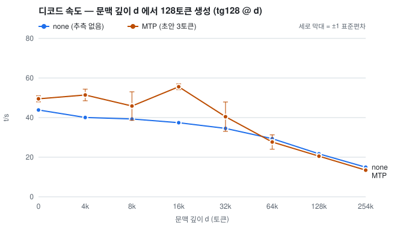
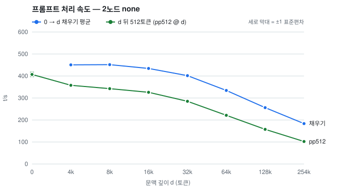

# llm-engine-for-libtbvcoll

Run one large MoE language model on **two laptops at once, with tensor parallelism (TP)**.

- **Hardware:** two HP ZBook Ultra G1a (AMD Strix Halo, Radeon 8060S `gfx1151`, 128 GB unified memory) joined by Thunderbolt/USB4 cables.
- **Transport:** each layer's partial sums are exchanged by RDMA over USB4 with
  [tbv](https://github.com/mminggmmingg/thunderbolt-ibverbs-zbook), an ibverbs driver for the USB4 host interface.
- **Model:** Qwen3.8-Flash-Next (`qwen4exp`: 512-expert MoE, 48 layers, hyper-connections, 12 sparse-attention "QSA" layers with a
  lightning indexer, an MTP draft head, up to 262,144 tokens of context), quantized with our own mix **H5** (92 GiB).
- **Software:** llama.cpp `e09a78a` plus [our patch](patches/llama-e09a78a-engine2n-t5.patch) (ROCm 7.2.1, HIP).

## Results (2026-11-13)

**Short prompts** (6 prompts × up to 256 tokens, greedy):

| Setup | Decode | Notes |
|---|---:|---|
| 2 nodes, TP | **46.3 t/s** | each node reads 2.83 GB of weights per token → 131 GB/s per node |
| 2 nodes, TP + MTP speculative decoding | **63.5 t/s** | 3 draft tokens from the model's own MTP layer, acceptance 0.64 |
| 1 node (reference, 2026-10-30 engine) | 18.5 / 31.2 t/s | later work was measured on 2 nodes only |

**Long context** (decode after d tokens already in the cache; full table below):

| Tokens already in the cache | none: before → after the 11-12 kernels | MTP: before → after |
|---|---:|---:|
| 32k | 34.6 → **37.5 t/s** (+8%) | 40.5 → **44.4 t/s** |
| 128k | 21.7 → **31.1 t/s** (+43%) | 20.5 → **22.6 t/s** |
| 254k (260,096 tokens, 1 run) | 14.9 → **26.4 t/s** (+77%) | 13.5 → **16.3 t/s** |

- Prompt processing at depth got the same kind of skip on 2026-11-13: filling 128k tokens went from 282 to **352 t/s** (+25%),
  and 512 more tokens after 128k from 175 to **239 t/s** (+37%) (alternating runs, same output).
- Beyond ≈64k tokens, plain decoding is faster than MTP.

- **Goal:** ≥ 85% of the per-node memory bandwidth (239.7 GB/s measured GPU read, 256 GB/s theoretical).
  Today 61.2% / 61.6% (nodes A / B, counting the measured 3.17 / 3.19 GB of DRAM reads per token); 85% would be ≈ 64 t/s without MTP.
- Day-to-day variation is about ±2%; every change was judged by alternating runs on the same day (see [RESULTS.md](RESULTS.md)).
- The full history of how the numbers got here is in the [experiment journal](docs/JOURNAL.md) (Korean).

## Performance by context length

Decode and prompt-processing speed when d tokens are already in the KV cache, measured 2026-11-12/13 with the long-context
kernels described below. The dashed gray line is plain decoding (none) measured on the afternoon of 2026-11-12, before those kernels.

| Context depth d (tokens) | Context fill t/s | Fill time s | pp512 @ d t/s | tg128 @ d t/s (none) | tg128 @ d t/s (MTP) | MTP acceptance |
|---:|---:|---:|---:|---:|---:|---:|
| 0 | — | — | 385.4 ± 22.4 | **44.4 ± 0.4** | **47.3 ± 1.6** | 51% ± 4 |
| 4,096 (4k) | 448.6 ± 3.0 | 9.1 ± 0.1 | 360.7 ± 2.2 | **41.2 ± 0.1** | **49.6 ± 3.8** | 62% ± 6 |
| 8,192 (8k) | 445.3 ± 7.0 | 18.4 ± 0.3 | 342.0 ± 2.3 | **40.6 ± 0.2** | **42.9 ± 8.5** | 52% ± 18 |
| 16,384 (16k) | 428.7 ± 2.3 | 38.2 ± 0.2 | 324.8 ± 3.8 | **39.4 ± 0.0** | **54.9 ± 2.5** | 86% ± 5 |
| 32,768 (32k) | 388.1 ± 0.3 | 84.4 ± 0.1 | 276.0 ± 5.3 | **37.5 ± 0.3** | **44.4 ± 5.1** | 68% ± 13 |
| 65,536 (64k) | 328.6 ± 0.5 | 199.5 ± 0.3 | 220.0 ± 1.6 | **34.8 ± 0.1** | **34.7 ± 1.8** | 62% ± 3 |
| 131,072 (128k) | 256.2 ± 0.6 | 511.6 ± 1.2 | 161.0 ± 0.7 | **31.1 ± 0.1** | **22.6 ± 3.4** | 54% ± 15 |
| 260,096 (254k) | 183.1 (1 run) | 1420.6 (1 run) | 105.7 (1 run) | **26.4 (1 run)** | **16.3 (1 run)** | 64% (1 run) |

<picture>
  <source media="(prefers-color-scheme: dark)" srcset="docs/ctx/ctx-decode-dark.svg">
  
</picture>

<picture>
  <source media="(prefers-color-scheme: dark)" srcset="docs/ctx/ctx-prefill-dark.svg">
  
</picture>

**Terms** (named as in `llama-bench`)
- **Context fill**: processing d tokens into an empty cache — close to the time to first token for a long document.
- **pp512 @ d**: processing 512 new tokens when d tokens are already cached (continuing a conversation).
- **tg128 @ d**: then generating 128 tokens greedily. MTP acceptance = accepted drafts / proposed drafts.
- Values are mean ± standard deviation over 3 runs (depth 260,096: 1 run); k = 1024 tokens. Fill and pp512 are from the none runs
  (the MTP runs are within 6%).
- The MTP column was measured just before a 2026-11-13 fix that made each MTP draft ≈0.4 ms faster (MTP +4% at short context;
  see the top-k item below). Plain decoding (none) is not affected.

**Method**
- Following `llama-bench -d/--n-depth` ([tools/llama-bench/README.md](https://github.com/ggml-org/llama.cpp/blob/master/tools/llama-bench/README.md))
  and [llama-benchy](https://github.com/eugr/llama-benchy), which applies the same idea to an OpenAI-style server (both checked 2026-11-12).
- Our engine runs as `llama-server` over two RPC servers, so `tools/bench/ctx_bench.py` sends the same sequence to `/completion`:
  1. d tokens of text with `n_predict 0` → context fill (the server reports `prompt_n = d`);
  2. the same d tokens + the next 512 tokens with `n_predict 128`, `cache_prompt`, temperature 0, `ignore_eos` → the server reuses
     the cached d tokens and processes 512 (`prompt_n = 512` is checked on every run) → pp512 @ d and tg128 @ d.
  - Each measurement starts at a different place in the text (1024-token stride), so no run reuses another's cache.
    One unrecorded warm-up request first. All times are the server's own `timings`.
- Text: the docs (`docs/**/*.md`, `tools/server/README.md`) and `src/*.cpp` of upstream llama.cpp `e09a78a`, 4.76 MB
  (`tools/bench/ctx_corpus.sh`, sha256 `7dccee037059a590b1bff906ac2e7c68a1205eb5f8c3f1e923020149cc50c208`; regenerate it with the script).
  Real text matters for MTP: acceptance depends on what is being written.
- Server: `-c 262144` (the model's full context, f16 KV), `-fa on`, `-b 2048 -ub 512` (defaults), one slot. Depth 260,096 is the
  largest that leaves room for 512 + 128 tokens.
- Raw data: `fixcost/ctx-1112/` (before the long-context kernels) and `fixcost/longctx-1112/` (after); tables and charts by
  `tools/bench/ctx_plot.py`.

**What the numbers say**

- **Why decoding slows with context.** Only the 12 QSA layers depend on the context length: a lightning indexer scores one
  pooled key per 4 tokens, a top-k picks 512 of them, and flash attention runs under the resulting mask. A kernel trace of server A
  (`tools/bench/kdepth.py`, µs per decoded token):

  | Kernel (12 QSA layers) | depth 0 | 128k before | 128k after |
  |---|---:|---:|---:|
  | flash attention (`flash_attn_tile`) | 79 | 9,800 | **1,360** |
  | indexer: gather pooled keys (`get_rows` f16 → f32 copy) | 0 | 4,008 | **0** (merged into the indexer) |
  | indexer: scores (`lightning_indexer`) | 0 | 1,323 | 4,350 |
  | top-k | 0 | ≈500 | 1,054 |
  | **all kernels of one token** | **19.4 ms** | **38.5 ms** | **26.8 ms** |

- **What changed** (server-side CUDA/HIP only; the client graph is unchanged and each change has an off-switch in
  [docs/SWITCHES.md](docs/SWITCHES.md)):
  1. Flash attention skips each 32-token KV chunk that the mask hides from every query in the block. A hidden chunk changes
     neither the running maximum, nor the sum, nor the output, so the result is bit-identical. Before, HIP read the whole cache;
     the sparse path in `fattn.cu` is NVIDIA-only.
  2. The 1–7-token indexer reads its pooled keys directly from the cache rows by index instead of copying them first.
  3. Top-k is one radix-select kernel per row (was 11 kernels). It returns the same elements and breaks ties by column order.
     It is used only for rows of up to 64k columns (the QSA pools). For a whole-vocabulary row, such as the top-10 sampling of
     each MTP draft, the original multi-block kernel is faster. The first version used it there too and cost MTP 4%.
- **Deterministic outputs at long context.** The old top-k broke ties between equal scores in atomic order, during prompt
  processing too, so the same request could produce different text at 32k (two different hashes were seen). With the new top-k,
  4 repeated runs gave identical output at 8k and 32k, and 128k matched with the other two changes switched off.
- **MTP at long context.** MTP is faster up to 32k, equal at 64k and slower beyond (inference watcher, steps split by depth with
  `tools/watch/ctxseg.py`):
  - The attention part of a 4-token verification step grows from 4.2 to 25.8 ms between depth 0 and 128k, against 2.8 → 10.7 ms
    for a 1-token step. Likely cause (from the code, not measured per kernel): each of the 4 queries picks its own 512 blocks, and a
    chunk is skipped only when all 4 queries hide it.
  - The MTP head is a full-attention layer without an indexer (compress ratio 0), and it runs on node A only. Its draft steps
    slow from 2.9 to 6.6 ms each.
- **Prompt processing** was unchanged by the kernels above (within ±3%). A kernel trace of a 128k fill then showed the batched
  flash-attention kernel (MMA) taking 49% of the GPU time (`tools/bench/ppk.py`). On 2026-11-13 that kernel got the same skip:
  a 64-token KV chunk is skipped when the mask hides it from all 16 queries of a tile (`GGML_CUDA_NO_FA_MMA_SKIP` turns it off).
  Alternating runs at the same text position, identical output (two values = two pairs):

  | Depth | Context fill t/s, off → on | pp512 @ d t/s, off → on |
  |---:|---:|---:|
  | 8k | 452.8 / 448.5 → 438.2 / 442.5 (−2%) | 359.2 / 352.3 → 354.2 / 353.2 (−1%) |
  | 16k | 442.5 → 447.0 (+1%) | 327.9 → 336.5 (+3%) |
  | 32k | 409.3 → 425.6 (+4%) | 292.6 → 310.4 (+6%) |
  | 64k | 356.9 → 397.1 (+11%) | 240.9 → 280.9 (+17%) |
  | 128k | 283.0 / 281.4 → 352.7 / 350.5 (**+25%**) | 176.0 / 174.2 → 239.5 / 238.8 (**+37%**) |

  t/s = tokens / the server's own prompt time; a 128k fill takes 372 s with the skip (464 s without). The context table above
  was measured before this change, at other text positions.

## How it works

```
node A: llama-server (client; the MTP drafts run on A's GPU)
          ├─ RPC → rpc-server A  (A's GPU, half of every layer, rank 1)
          └─ RPC → rpc-server B  (B's GPU, half of every layer, rank 0)
                   rpc-server A ⇄ rpc-server B : 2 all-reduces per layer (tbv RDMA, ≈10 KB per token)
```

| | Both nodes |
|---|---|
| Machine | HP ZBook Ultra G1a 14 — Ryzen AI MAX+ PRO 395, Radeon 8060S (gfx1151), 128 GB |
| Memory | BIOS VRAM 4 GiB, GTT 112 GiB (`ttm.pages_limit=29360128`) |
| Software | Ubuntu 26.04.1, kernel 7.0.0-1015-oem, ROCm 7.2.1, llama.cpp `e09a78a` + our patch |
| Link | 2 Thunderbolt cables → RDMA devices `usb4_rdma0`, `usb4_rdma5`; control IP on `thunderbolt0` (10.99.0.1 / 10.99.0.2) |
| Transport | tbv `9a35117` or later; bundle in [zbook-thunderbolt-RDMA](https://github.com/mminggmmingg/zbook-thunderbolt-RDMA) |

- **Tensor parallelism only.** Attention/GDN projections, the active experts and the output head are split in half; small tensors
  (hyper-connections, shared expert, router, indexer) are replicated. No layer splitting or pipeline parallelism. No hardware,
  power or firmware tuning — software only.
- **All-reduce inside the GPU stream.** The GPU writes its partial sum and a flag straight to host memory, a proxy thread sends it over
  RDMA, and the kernel that next reads the sum waits for the peer's flag and adds it itself. The 40 KB all-reduces of MTP verification
  are split over both cables.
- **Fewer, fused kernels.** About 1,060 kernels per token (from 2,720), many groups fused on the server side by recognizing node
  patterns, so the client graph — and the output — stay the same.
- **Long context.** The QSA layers attend to the top 512 blocks (of 4 tokens) picked by the indexer, plus the newest tokens.
  The flash-attention kernels (decode and prompt processing) skip the KV chunks the mask hides, the indexer reads its keys straight
  from the cache, and the top-k is one deterministic kernel (2026-11-12/13, see above).
- **Speculative decoding** with the model's MTP layer: drafts use a reduced 104,459-token vocabulary and a low-bit copy of the head;
  outputs are decided by the main model.
- Step-by-step history with numbers: [docs/JOURNAL.md](docs/JOURNAL.md). Design notes: [DESIGN.md](DESIGN.md),
  [docs/DESIGN_megakernel.md](docs/DESIGN_megakernel.md), inefficiency audit [docs/INEFFICIENCY_20261108.md](docs/INEFFICIENCY_20261108.md).

## Output correctness

- Every change is checked against reference hashes of the 6 benchmark outputs (256 tokens each), per mode:
  - none: `6c1596 ce5ae3 ecfc02 810ea2 a27f06 e0ee11`
  - MTP (3 drafts): `d28991 344aad 5942d0 412ba5 a27f06 e0ee11`
  - check with `python3 -I fixcost/gluhc-1108/hashchk.py runs/.../bench.txt` (the mode is read from the file name).
- **Why two references.** This engine is sensitive to graph shape: adding one unused node to the graph changes the logits slightly
  (first at layer 39, ≈1e-3) and greedy text then diverges at near-ties. The short-context QSA shortcut (2026-11-12) changed the graph
  that way, differently for 1-token and 4-token graphs. Quality is unchanged: KLD against the Q8_0 original is identical with and
  without it (0.067849, top-1 agreement 94.706%), and every divergence point is a near-tie (0.006–0.137 nats). The previous reference
  (`c400cb 40b428 572e7e 412ba5 e5be2a d67a87`, same for none and MTP) is still produced with `LLAMA_QSA_SHORT=0`.
  Since then, optimizations are done as server-side fusions that leave the client graph alone.
- **Long-context outputs are deterministic** since 2026-11-12: the old multi-kernel top-k broke ties in atomic order, so outputs at
  long context differed from run to run. The new kernels were checked bit for bit with their off-switches at depths 8k, 32k and 128k.
- Fused kernels are skipped when the allocator places an output over a live input; each fusion has an off-switch and most a
  `*_VERIFY` mode — see [docs/SWITCHES.md](docs/SWITCHES.md).
- Changes that do alter bits are judged by KLD against the Q8_0 original, top-1 agreement and the log-probabilities at the divergence
  points (`tools/divergence.py`, `tools/layerdiff.py`).

## Getting started

Build (inside the `rocm/vllm-dev:rocm7.2.1` container, HIP gfx1151 + RPC + RDMA):
```
git clone https://github.com/ggml-org/llama.cpp && git -C llama.cpp checkout e09a78a
git -C llama.cpp apply ../patches/llama-e09a78a-engine2n-t5.patch     # from the top of this repository
./build_llama.sh                     # + llama-quantize, llama-imatrix
./eval/make_ppl_text.sh
./get_models.sh iq4                  # Qwen3.8-Flash-Next UD-IQ4_XS (93.7 GB, sha256 checked); H5 is made with quant/ (see the journal)
```
Run:
```
./run_1node.sh <q4|iq4|GGUF>                 # 1-node reference
./run_tp.sh <GGUF|iq4> local                 # TP check on node A alone (2 rpc-servers)
./run_tp.sh <GGUF|iq4> 2node [rdma|tcp]      # 2-node TP: --rpc 10.99.0.2:50052,127.0.0.1:50052 (B = rank 0)
./eval_ppl.sh <GGUF> 1node|tplocal|tp2node   # perplexity
./run_server.sh 1node|2node none|mtp [N]     # llama-server benchmark (with speculative decoding), prompts in eval/spec_prompts.json
```
Context-length benchmark (same conditions as above):
```
tools/bench/ctx_corpus.sh <llama.cpp dir> e09a78a $PWD/corpus.txt          # 4.76 MB of text, sha256 7dccee03…
export SRV_EXTRA="-c 262144" TRACE=0 BENCH_S=5400
BENCH="tools/bench/ctx_bench.py $PWD/corpus.txt 0,4096,8192,16384,32768,65536,131072 3 {OUT}/ctx.jsonl" tools/bench/srv-probe.sh 2node none   # same for mtp
python3 -I tools/bench/ctx_plot.py docs/ctx none=runs/<none run>/ctx.jsonl mtp=runs/<mtp run>/ctx.jsonl   # table (ctx-table.md) and SVGs
```
The MTP draft file: the shared MTP GGUF from `./get_models.sh mtp` borrows `token_embd` and `output` from the main model, so this
llama.cpp cannot open it alone. Attach the two tensors from the main model, cut the draft vocabulary and requantize
(`run_server.sh` uses the result by default):
```
python3 -I tools/gguf_merge_mtp.py <MTP/mtp-...-shared-Q8_0.gguf> <UD-IQ4_XS/...-00002-of-00003.gguf> <MTP/mtp-...-merged-IQ4embd.gguf> token_embd.weight output.weight
BENCH="tools/draft_vocab_corpus.py $PWD/eval/draft_vocab_prompts.json 384 $PWD/corpus-tokens.jsonl" MTP=<merged-IQ4embd.gguf> tools/bench/srv-probe.sh 2node mtp
python3 -I tools/draft_vocab_select.py corpus-tokens.jsonl 98304 <MTP/mtp-...-merged-IQ4embd.gguf> ids-96k-ko.txt ko
python3 -I tools/gguf_draft_vocab.py <MTP/mtp-...-merged-IQ4embd.gguf> ids-96k-ko.txt <MTP/mtp-...-merged-IQ4embd-dv96k-ko.gguf>
llama-quantize --allow-requantize --pure --tensor-type-file fixcost/dvocab-1106/draft-qmix.types <...-dv96k-ko.gguf> <MTP/mtp-...-merged-IQ4embd-dv96k-ko-qmix.gguf> Q8_0
```

## How we measure

- `run_server.sh` (= `tools/bench/srv-probe.sh`) starts both rpc-servers and llama-server, runs `tools/spec_bench.py` (6 prompts)
  and stops them. Results: `runs/srv-<topo>-<spec>-<time>/results.jsonl` (per-prompt t/s, drafts, output hashes) plus GPU clock and
  power logs of both nodes. `BENCH=` runs another client (for example `tools/bench/ctx_bench.py`) against the same servers.
- On/off comparisons use `tools/bench/node-ab.sh`: configurations are alternated, runs whose all-reduce link did not come up as RDMA
  are repeated, speed runs have tracing off, and each configuration also gets one traced run for the inference watcher, summarized
  in `watch-summary-*.md` (step time, all-reduce latency, causes of waits over 1 ms, DRAM bytes per token).
- Before measuring: `platform_profile` must be `performance` on both nodes (a reboot can bring it up in power-saving mode, ≈10% slower),
  no other GPU work on the peer, no builds during a measurement (it overwrites the running binaries), and no earlier benchmark script
  still running.
- Time breakdowns: the inference watcher (below), `tools/bench/prof2node.sh` (rocprofv3 kernel trace of server A; `BARGS="-p 0 -n 32 -d <depth>"`
  for a given depth), `tools/bench/kdepth.py` (per-token kernel time by depth), `tools/watch/ctxseg.py` (watcher steps split by depth),
  `tools/bench/mtpcycle.py` (one MTP cycle).

## Inference watcher reports

With the watcher (`inferwatch`; the version up to 2026-11-10 lives in `tools/watch/`, later versions are pinned copies from a separate
repository — `IW` in `tools/bench/node-ab.sh`), every run leaves `runs/watch/<time>/report.html` (timeline and receipt) and `receipt.md`.
Four reports from 2026-11-05/07 are in `docs/watch/` (download the HTML, ≈11 MB each). They are older than today's engine; recent
comparisons are the `fixcost/*/watch-summary-*.md` files, for example [the 11-12 fusions](fixcost/fuse-1112/watch-summary-1112-133002.md).

| Report | Situation | Decode t/s (server) |
|---|---|---:|
| [none, after 10 fusions](docs/watch/20261105-0217-none-fusions.html) · [receipt](docs/watch/20261105-0217-none-fusions-receipt.md) · [image](docs/watch/20261105-0217-none-fusions.png) | 11-05 02:17, 1-token decode | 35.4 |
| [none, server-side argmax](docs/watch/20261105-2003-none-argmax.html) · [receipt](docs/watch/20261105-2003-none-argmax-receipt.md) · [image](docs/watch/20261105-2003-none-argmax.png) | 11-05 20:03, all-reduce through the host (ZC=1) | 36.45 |
| [none, in-stream all-reduce + prefetch](docs/watch/20261107-0443-none-zc3-prefetch.html) · [receipt](docs/watch/20261107-0443-none-zc3-prefetch-receipt.md) · [image](docs/watch/20261107-0443-none-zc3-prefetch.png) | 11-07 04:43 (tracing costs ≈6%) | 39.17 |
| [MTP](docs/watch/20261105-1702-mtp.html) · [receipt](docs/watch/20261105-1702-mtp-receipt.md) · [image](docs/watch/20261105-1702-mtp.png) | 11-05 17:02, 3 drafts | 45.85 |


The timeline shows the client's decode steps, client → A/B commands, both server threads and GPUs, the partial sums between the
nodes (red = took over 1 ms), GPU clocks and socket power. The receipts break each step into GPU compute and idle time, client time,
all-reduce latency and where the GPU waited. The reports' own text is in Korean.

## Limitations and known issues

- Scripts use our machines' paths and addresses (`/data/parksThink/...`, `10.99.0.1/2`); set `MODEL`, `MTP`, `BIN` and the addresses
  in the scripts for another setup.
- Long context, decode: the indexer now reads 256 B of pooled key every 2 KB of cache row, ≈23 GB/s. At 128k it is the largest
  context-dependent cost (4.35 ms per token). Keeping the pooled keys in their own dense array would cut this to an estimated
  ≈40 µs per layer.
- Long context, prompt processing is still slow: filling 128k tokens runs at ≈350 t/s (about 6 minutes) even with the chunk skip,
  because a 64-token chunk can be skipped only when none of the 16 queries of a tile picked it.
- MTP acceptance depends on the text, and beyond ≈64k tokens of context MTP is slower than plain decoding. There is no adaptive
  draft length and no automatic switch.
- none and MTP outputs differ slightly since 2026-11-12 (see Output correctness). Draft lengths of 4 or more change outputs again
  (a 5-token verification batch changes the rounding order); the default is 3.
- Once, during a 260k-token prompt (2026-11-12, about 16 minutes into the fill), the client lost its RDMA connection to server B
  ("RDMA CQ wc error: status=5 (Work Request Flushed Error)"); both servers stayed up and the kernel log only shows retransmissions.
  Cause unknown; the same run repeated finished.
- On 2026-11-12 at 23:46, one of the two cables (`usb4_rdma0`) dropped on both nodes for 7 seconds and came back by itself; tbv
  re-registered the device. It happened between two runs, so no measurement was affected. Cause unknown.
- If the all-reduce link does not come up at server start (`[comm_init] failed to connect to peer`) the engine falls back to TCP:
  very slow, and the output hashes differ (cause unknown; a restart fixes it).
- B is rank 0: registering server A by its Thunderbolt address makes the client↔A connection go through tbv loopback, and tbv cannot
  connect two QPs on the same node.
- Many fusions are specific to this model (`qwen4exp`) and gfx1151; other models and GPUs mostly take the original paths.

## Repository layout

- `run_*.sh`, `eval_ppl.sh`, `build_llama.sh`, `get_models.sh` + `models_manifest.json`: build, model download, run scripts
- `patches/`: all our changes to llama.cpp `e09a78a` (one diff)
- `tools/`: measurement and analysis (`spec_bench.py`, `bench/` including the context-length tools `ctx_corpus.sh`, `ctx_bench.py`,
  `ctx_plot.py`, `watch/`, GGUF and draft-vocabulary tools); `tools/probe/`: read-only node and GPU checks
- `eval/`: evaluation prompts and text generators
- `quant/`: quantization mix experiments (type files, logs)
- `fixcost/`: raw data per experiment (logs, kernel tables, per-run records), referenced from RESULTS.md
- `docs/`: [JOURNAL.md](docs/JOURNAL.md) (experiment journal), [SWITCHES.md](docs/SWITCHES.md) (patch, environment and tool notes),
  `ctx/` (context-length table and charts), `watch/` (watcher reports)

Documents: [DESIGN.md](DESIGN.md) (TP design; the abandoned layer-split design is [DESIGN_v0_pp.md](DESIGN_v0_pp.md)),
[RESULTS.md](RESULTS.md) (measurement log, date order). Most project documents are in Korean. The first 7 commits of this repository
are the `engine2n/` history moved from [zbook-thunderbolt-RDMA](https://github.com/mminggmmingg/zbook-thunderbolt-RDMA).

## License

GPL-3.0 — [LICENSE](LICENSE). Copyright (C) 2026 mminggmmingg. Modified versions must also be distributed with source under GPL-3.0.
The original llama.cpp code inside `patches/` (the diff's context lines) is under llama.cpp's MIT license (Copyright (c) 2023-2026
The ggml authors).
