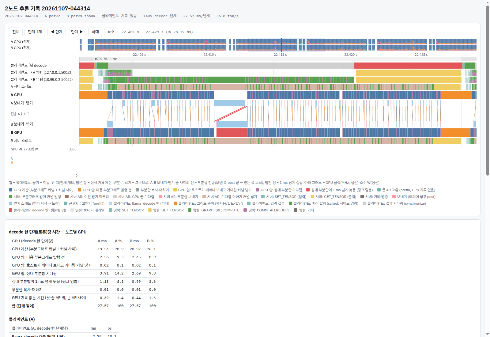

# llm-engine-for-libtbvcoll

노트북 두 대로 큰 MoE 언어 모델을 **텐서 병렬(TP)** 로 돌리는 llama.cpp 기반 엔진이다.
HP ZBook Ultra G1a(AMD Strix Halo, Radeon 8060S gfx1151, 메모리 128 GB) 두 대를 Thunderbolt/USB4 케이블로 잇고,
층마다 두 GPU 의 부분합을 USB4 RDMA([tbv](https://github.com/mminggmmingg/thunderbolt-ibverbs-zbook))로 주고받는다.
대상 모델은 Qwen3.8-Flash-Next(qwen4exp — 512 전문가 MoE, 48층, hyper-connection)이고, 가중치는 우리 비트 배분 H5(92 GiB)다.

## 결과 (2026-11-07 오전)

| 구성 | 디코드 tok/s | 비고 |
|---|---:|---|
| 2노드 TP | **40.4** | 토큰마다 노드 하나가 가중치 2.83 GB 를 읽음 → 노드당 114 GB/s, 메모리 대역폭의 48% |
| 2노드 TP + MTP 추측 디코딩 | **56.2** | 초안 3토큰(모델의 MTP 층), 채택률 0.64 |
| (참고) 1노드, 같은 모델 | 18.5 / MTP 31.2 | 2026-10-30 엔진, A 의 느린 상태. 그 뒤 개선은 2노드로만 쟀다 |

- 측정: llama-server, greedy(temperature 0), 프롬프트 6개(영어 글·코드·한국어·수학·JSON·요약) × 256 토큰, 서버가 잰 디코드 속도의 토큰 가중 평균.
- **출력은 비트 그대로다.** 최적화마다 같은 프롬프트의 출력 해시가 바뀌지 않는지 확인했고, MTP 를 켜도 MTP 없는 greedy 와 출력이 같다.
- **목표: 노드당 메모리 대역폭의 85% 이상.** 기준은 1노드 GPU 읽기 실측 239.7 GB/s(이론 256 GB/s) — H5 2노드 none 이면 ≈72 tok/s(≥204 GB/s).
- 다음 단계 설계: 구간별 큰 커널(AR 사이 부분그래프 하나 = 상주 블록 커널 하나, 동기화 0.3–0.7 µs, 가중치 앞서 읽기·MALL) — [docs/DESIGN_megakernel.md](docs/DESIGN_megakernel.md).
- 날마다 노드 상태에 따라 ±2% 흔들린다. 같은 날 번갈아 잰 끔/켬 비교는 [RESULTS.md](RESULTS.md) 의 각 절에 있다.

## 구성

```
노드 A: llama-server (클라이언트; MTP 초안은 A GPU 에서)
          ├─ RPC → rpc-server A  (A GPU, 모든 층의 절반, rank 1)
          └─ RPC → rpc-server B  (B GPU, 모든 층의 절반, rank 0)
                   rpc-server A ⇄ rpc-server B : 층마다 all-reduce 2번 (tbv RDMA, 1토큰 ≈10 KB)
```

| | 두 노드 같음 |
|---|---|
| 기기 | HP ZBook Ultra G1a 14 — Ryzen AI MAX+ PRO 395, Radeon 8060S (gfx1151), 128 GB |
| 메모리 설정 | BIOS VRAM 4 GiB, GTT 112 GiB (`ttm.pages_limit=29360128`) |
| 소프트웨어 | Ubuntu 26.04.1, 커널 7.0.0-1015-oem, ROCm 7.2.1, llama.cpp `e09a78a` + [우리 패치](patches/llama-e09a78a-engine2n-t5.patch) |
| 링크 | Thunderbolt 케이블 2개 → RDMA 장치 `usb4_rdma0`·`usb4_rdma5`, 제어용 IP `thunderbolt0` 10.99.0.1 / 10.99.0.2 |
| 전송 | tbv `9a35117` 이상 — USB4 NHI 위의 ibverbs 드라이버. 묶음은 [zbook-thunderbolt-RDMA](https://github.com/mminggmmingg/zbook-thunderbolt-RDMA) |

원칙: 다중 노드는 TP 만 쓴다(층 분할·파이프라인 병렬은 쓰지 않음). 하드웨어·전원·펌웨어 설정은 바꾸지 않는다(소프트웨어만).

## 어떻게 빨라졌나

2노드 TP 디코드가 올라온 과정. 가중치는 모두 H5. 11-03 부터의 변경은 모두 출력이 그대로다.

| 날짜 | 바뀐 것 | 토큰당 읽는 가중치 GB (노드당) | 2노드 TP | 2노드 TP + MTP | 가중치 읽기로 환산 GB/s (노드당) | 대역폭 활용 (239.7 GB/s 대비) |
|---|---|---:|---:|---:|---:|---:|
| 10-30 | 우리 비트 배분 H5 | 2.96 | 25.4 | 34.8 | 75 | 31% |
| 10-30 | 불러올 때 가중치 합치기(같은 날 끔 24.4 / 34.3) | 2.96 | 25.9 | 36.4 | 77 | 32% |
| 10-31 – 11-01 | 라우터 BF16, GDN 상태 캐시에서 바로 읽기, 받는 쪽 zero-copy AR, q8_1 활성값 캐시 등(11-03 아침 기준선) | 2.83 | 27.3 | 38.7 | 77 | 32% |
| 11-03 | 작은 연산 묶기·DPP(토큰당 커널 2720 → 1806) | 2.83 | 32.2 | 42.4 | 91 | 38% |
| 11-03 – 11-04 | 묶기 셋, 단계 시작 GPU 쉼 줄이기, greedy argmax, AR 링크를 두 번째 케이블로 | 2.83 | 33.6 | — | 95 | 40% |
| 11-04 | hc 블록 묶기(11-05 최종 비교의 '끔') | 2.83 | 34.4 | 42.9 | 97 | 40% |
| 11-05 새벽 | 값 그대로 커널 묶기 10개 더(A 노드 토큰당 커널 1886 → 1313) | 2.83 | 36.3 | 43.8 | 103 | 43% |
| 11-05 오후 | 서버 쪽 argmax — 로짓 대신 (최댓값, 번호)만 받음(같은 날 끔 35.4 / 44.2) | 2.83 | 36.5 | 45.5 | 103 | 43% |
| 11-06 | MTP 초안 출력층을 어휘 104459개로 줄임 — 초안만 바뀌고 출력은 그대로(같은 날 기준 MTP 46.7) | 2.83 | 36.3(초안 없음, 그대로) | 50.3 | 103 | 43% |
| 11-06 | 초안 가중치를 본 모델과 같은 낮은 비트로(같은 회차 어휘만 줄인 판 49.9) | 2.83 | 36.3 | 50.8 | 103 | 43% |
| 11-06 저녁 | AR 을 스트림 안에서(ZC=3 + 앞서기 2) — 호스트 왕복을 GPU 경로에서 뺌(같은 날 ZC=1 36.5 / 48.9) | 2.83 | 38.5 | 52.4 | 109 | 45% |
| 11-07 새벽 | AR 을 기다리는 동안 다음 가중치를 MALL 로 미리 읽기(같은 회차 끔 38.45 / 54.0) | 2.83 | 39.4 | 54.7 | 111 | 46% |
| 11-07 오전 | 엔진을 Thunderbolt 인터럽트 CPU 밖에서 — 받은 메시지를 마무리하는 kworker 와 CPU 를 나눠 쓰지 않게(같은 회차 고정 없음 39.15 / 54.9) | 2.83 | 39.6 | 56.0 | 112 | 47% |
| **11-07 낮** | **tbv 가 받은 프레임을 높은 우선순위 작업에서 마무리(드라이버 패치) + AR 을 클라이언트가 안 쓰는 케이블로(같은 드라이버 같은 케이블 39.6 / 55.4)** | **2.83** | **40.4** | **56.2** | **114** | **48%** |

- 토큰당 읽는 가중치: 디코드 1단계에 노드 하나가 읽는 양(`tools/bytes_per_token.py 512 10 loaded tp=2`). 나뉘는 텐서(attention·GDN 투영, 활성 전문가, 출력층)는
  절반, 두 노드에 복제되는 텐서(hyper-connection, shared expert, 라우터, indexer)는 전부. KV 캐시·GDN 상태·임베딩 조회는 뺐다. MTP 는 한 단계에 여러 토큰을 검증하므로
  이 값이 생성 토큰당 양은 아니다.
- 환산 GB/s = 노드당 GB × tok/s(MTP 없음). 큰 행렬곱 하나가 내는 ≈220 GB/s 의 절반쯤이다. 1토큰 27.5 ms 중 가중치만 읽는 시간은 ≈12.6 ms 이고,
  나머지가 작은 커널(토큰당 ≈1300개, 하나에 ≈3 µs 의 발행 바닥)·all-reduce·토큰 경계다.

큰 단계만 간추리면(자세한 수치·실패한 시도는 RESULTS.md):

- **불러올 때 가중치 합치기**(10-30): 입력이 같은 행렬 168쌍을 한 텐서로 — 커널 수가 줄어 2노드 +9.5%.
- **작은 연산 묶기**(11-03 – 11-05): 토큰당 커널 2720 → 1313. gfx1151 의 mmvq 는 열 수와 상관없이 워프 하나가 한 행을 같은 순서로 더하므로,
  32워프 블록이 연속 32행을 맡게 묶으면 비트가 같다. hc 블록, GLU → q8_1, shared expert 꼬리, GDN 게이트·norm, all-reduce 기다림-더하기를 처음 읽는 커널 안에서 등.
- **서버 쪽 argmax**(11-05): 클라이언트가 토큰마다 두 노드의 로짓(노드당 ≈0.5 MB)을 받던 것을 각 노드가 (최댓값, 번호)만 돌려주게 — +3.1%.
- **MTP 초안 출력층 줄이기**(11-06): 초안이 읽는 0.67 GB 중 0.52 GB 가 전체 어휘(248320행) 출력층이었다. 초안만 104459행 어휘로 계산하고
  나머지 로짓은 -inf 로 둔다. 초안 제안만 바뀌고 출력은 본 모델 검증이 정하므로 그대로 — MTP +7.6%(벤치와 겹치지 않는 프롬프트에서도 +7.7%).
  이어서 초안(Q8_0 MTP 층 + Q6_K 출력층)을 본 모델 H5 와 같은 형식(Q5_0·IQ4_XS·IQ4_NL, 출력층 Q4_K)으로 다시 양자화 — 초안이 읽는 양 0.37 → 0.24 GB, +1–2%.
- **AR 을 기다리는 동안 다음 가중치 미리 읽기**(11-07): 작은 단계(hc down·hc up·라우터)는 가중치가 MALL(32 MB)에 있으면 2배 빠르다.
  GPU 가 상대 부분합을 기다리는 동안(토큰당 ≈4 ms) 기다림을 맡은 커널의 워프 128개가 이 부분그래프의 다음 행렬곱 가중치 16 MB 를 읽어 MALL 에 올린다
  (읽기만, 출력 그대로) — none +2.4%, MTP +1.1%. 이 실험 중 묶은 hc 블록 커널의 숨은 경쟁(보조 출력 silu 가 hc_pre 자리에 겹침)을 찾아 고쳤다.
- **엔진을 Thunderbolt 인터럽트 CPU 밖에서**(11-07 오전): 1 ms 넘게 늦은 AR 의 대부분은 선로가 아니라 받는 노드의 리눅스였다. NHI 인터럽트를 받은 CPU 의
  시스템 작업 큐 kworker 가 프레임을 마무리하는데, 엔진의 바쁜 대기 스레드가 같은 CPU 에 오면 3 ms 조각으로 나눠 쓰고(2.9 ms 튐), 1 초마다 도는 다른 커널 작업이
  그 풀에 앉으면 9–13 ms 를 기다린다(7–12 ms 튐). 스크립트가 노드마다 인터럽트 CPU 를 읽어 세 프로세스를 그 밖에 둔다(`tools/bench/tbcpus.sh`) — none +1.1%, MTP +2.1%.
  이어 tbv 드라이버가 받은 프레임을 CPU 별 높은 우선순위 작업 큐에서 마무리하게 고치고([tbv 브랜치 rx-highpri-poll](https://github.com/mminggmmingg/thunderbolt-ibverbs-zbook/tree/rx-highpri-poll),
  `tools/tbv_rxwq.sh`), AR 을 클라이언트 명령이 몰리지 않는 두 번째 케이블로 보내 1 ms 넘는 기다림이 단계당 1.7–2.4 → 0.75 ms — 둘을 합쳐 none +2.0%, MTP +2.1%.
- **AR 을 스트림 안에서**(11-06 저녁): AR 한 번을 GPU 도장으로 나눠 보니 252 µs 주기 중 GPU 가 호스트를 기다리는 몫(동기화에서 깨어남 7 + 보내기 9 + 다음 커널 시작 8 µs)이
  선을 기다리는 몫(17 µs)보다 컸다. GPU 가 부분합과 플래그를 호스트 메모리에 직접 쓰고 대리 스레드가 주고받는 경로(ZC=3)에 서버가 2 AR 까지만 앞서게 하니
  none +6%·MTP +7%(11-04 에는 커널이 많아 깊은 큐에서 느려져 졌던 경로).
- MTP 한 주기(어휘만 줄인 판) ≈54.5 ms 에 ≈2.9 토큰: 4토큰 검증(2노드) 45.7 ms + 초안 따라잡기 1.3 ms + 초안 3번 × 2.5 ms. 남은 큰 몫은 검증이다.

### 출력이 그대로인지 확인하는 법

- 기준 해시(6 프롬프트, 256 토큰): `c400cb 40b428 572e7e 412ba5 e5be2a d67a87`. none 과 MTP(초안 3 이하) 모두 같다.
- 묶은 커널은 할당기가 출력을 아직 읽히는 입력 자리에 놓으면 묶지 않는다(`ggml_cuda_overlaps_srcs`). 이 검사 없이 한 번, 상대 노드 GPU 를 다른 프로세스가 같이 쓸 때만
  출력이 바뀌는 경쟁이 있었다(RESULTS.md 2026-11-05 23:25). 새 묶기는 상대 노드에 GPU 부하를 띄엄띄엄 거는 조건(`fixcost/nondet-1105/repro.sh`)에서도 확인한다.
- 묶기마다 `*_VERIFY` 스위치(따로 돌린 결과와 비트 비교)가 있다 — 목록은 [docs/SWITCHES.md](docs/SWITCHES.md).
- 비트를 바꾸는 변경(예: 한 행을 여러 워프가 나눠 더하는 split-K)은 이렇게 판정한다: 같은 글 2048토큰의 로짓을 끔과 비교한 KLD 를 이미 받아들인
  반올림 차이(TP vs 1노드 0.0136, 한 번에 넣는 토큰 수 0.0124)와 견주고, Q8_0 원본 로짓과의 KLD·1위 일치, 정답이 정해진 문항 채점을 본다.
  이 모델은 반올림이 조금만 바뀌어도 활성값 8비트 양자화의 계단에서 차이가 커져 greedy 출력이 거의 동점인 자리에서 갈라진다 — 그 자체는 품질 손상이 아니다
  (RESULTS.md 2026-11-06 22:40, `tools/divergence.py`·`tools/layerdiff.py`).

## 시각 자료 — 추론 감시 보고서(inferwatch)

`tools/watch/inferwatch.sh start` 를 켜 두면 실행마다 두 서버·클라이언트의 기록 링을 모아 `runs/watch/<시각>/report.html`(타임라인 + 영수증 표)과
`receipt.md` 를 만든다(Rust, `tools/watch/`). 대표 넷을 `docs/watch/` 에 둔다 — HTML 은 받아서 브라우저로 연다(각 ≈11 MB, 그래프 데이터 포함).

| 보고서 | 상황 | 디코드 tok/s (서버 측정) |
|---|---|---:|
| [none, 묶기 10개 뒤](docs/watch/20261105-0217-none-fusions.html) · [영수증](docs/watch/20261105-0217-none-fusions-receipt.md) · [그림](docs/watch/20261105-0217-none-fusions.png) | 11-05 02:17, 1토큰 디코드 | 35.4 |
| [none, 서버 쪽 argmax 뒤](docs/watch/20261105-2003-none-argmax.html) · [영수증](docs/watch/20261105-2003-none-argmax-receipt.md) · [그림](docs/watch/20261105-2003-none-argmax.png) | 11-05 20:03, AR 이 호스트 왕복(ZC=1) | 36.45 |
| [none, AR 스트림 안 + 기다리는 동안 선읽기](docs/watch/20261107-0443-none-zc3-prefetch.html) · [영수증](docs/watch/20261107-0443-none-zc3-prefetch-receipt.md) · [그림](docs/watch/20261107-0443-none-zc3-prefetch.png) | 11-07 04:43, 지금 기본(기록 켠 탓에 ≈6% 느림) | 39.17 |
| [MTP](docs/watch/20261105-1702-mtp.html) · [영수증](docs/watch/20261105-1702-mtp-receipt.md) · [그림](docs/watch/20261105-1702-mtp.png) | 11-05 17:02, 초안 3 | 45.85 |



- 위 타임라인: 클라이언트 decode 단계, 클라이언트 → A·B 명령, 두 서버 스레드, 두 GPU, 노드 사이 부분합 전송(선, 빨강 = 1 ms 넘게 걸림), GPU 클럭·소켓 전력.
  휠 = 확대/축소, 끌기 = 이동, 단계 버튼 = 한 단계씩. 아래: 단계당 시간 영수증(GPU 계산·쉼, 클라이언트 몫), 단계 사이, AR 전송 지연, GPU 가 쉰 곳.
- 주의: MTP 는 초안 단계(A GPU 만)와 검증 단계가 섞여 평균이 나온다(나누기는 `tools/bench/mtpcycle.py`). 서버 쪽 argmax 뒤로는 llama_decode 가 로짓을
  기다리지 않고 돌아오고, 출력 읽기가 GET_TENSOR 대신 ARGMAX_ROWS 다(inferwatch 는 둘 다 출력 읽기로 본다). 그림은 헤드리스 Chrome 으로 찍은 첫 화면.
- ZC=3(스트림 안 AR)에서는 GPU 도장 대신 대리 스레드 기록으로 나눈다: 계산 = 앞 AR 이 풀린 때 → 우리 부분합 플래그를 본 때, 상대 기다림 = 그때 →
  상대 부분합 도착(그 사이 GPU 가 다음 커널을 돌릴 수 있어 기다림의 상한).

## 시작하기

준비(빌드는 `rocm/vllm-dev:rocm7.2.1` 컨테이너 안에서 HIP gfx1151 + RPC + RDMA):
```
git clone https://github.com/ggml-org/llama.cpp && git -C llama.cpp checkout e09a78a
git -C llama.cpp apply ../patches/llama-e09a78a-engine2n-t5.patch     # 저장소 최상위에서
./build_llama.sh                     # + llama-quantize, llama-imatrix
./eval/make_ppl_text.sh
./get_models.sh iq4                  # Qwen3.8-Flash-Next UD-IQ4_XS (93.7 GB, sha256 확인). H5 는 아래 '양자화 실험'
```
실행:
```
./run_1node.sh <q4|iq4|GGUF>                 # 1노드 기준
./run_tp.sh <GGUF|iq4> local                 # A 혼자 TP 점검(rpc-server 2개)
./run_tp.sh <GGUF|iq4> 2node [rdma|tcp]      # 2노드 TP: --rpc 10.99.0.2:50052,127.0.0.1:50052 (B = rank 0)
./eval_ppl.sh <GGUF> 1node|tplocal|tp2node   # 정합성(perplexity)
./run_server.sh 1node|2node none|mtp [N]     # llama-server 실측(추측 디코딩 포함), 프롬프트 eval/spec_prompts.json
```
MTP 초안 파일: `./get_models.sh mtp` 로 받는 공유형 MTP 파일은 본 모델의 `token_embd`·`output` 을 빌려 쓰는 형식이라 이 llama.cpp 가 단독으로 못 연다.
본 모델 조각에서 두 텐서를 붙이고, 출력층을 줄인 다음 낮은 비트로 다시 양자화한다(`run_server.sh` 기본). 말뭉치는 2노드 서버를 띄워 모은다
(우리 것은 `fixcost/dvocab-1106/corpus-tokens.jsonl`):
```
python3 -I tools/gguf_merge_mtp.py <MTP/mtp-...-shared-Q8_0.gguf> <UD-IQ4_XS/...-00002-of-00003.gguf> <MTP/mtp-...-merged-IQ4embd.gguf> token_embd.weight output.weight
BENCH="tools/draft_vocab_corpus.py $PWD/eval/draft_vocab_prompts.json 384 $PWD/corpus-tokens.jsonl" MTP=<merged-IQ4embd.gguf> tools/bench/srv-probe.sh 2node mtp
python3 -I tools/draft_vocab_select.py corpus-tokens.jsonl 98304 <MTP/mtp-...-merged-IQ4embd.gguf> ids-96k-ko.txt ko
python3 -I tools/gguf_draft_vocab.py <MTP/mtp-...-merged-IQ4embd.gguf> ids-96k-ko.txt <MTP/mtp-...-merged-IQ4embd-dv96k-ko.gguf>
llama-quantize --allow-requantize --pure --tensor-type-file fixcost/dvocab-1106/draft-qmix.types <...-dv96k-ko.gguf> <MTP/mtp-...-merged-IQ4embd-dv96k-ko-qmix.gguf> Q8_0
```

## 측정 방법

- `run_server.sh`(= `tools/bench/srv-probe.sh`)가 두 rpc-server 와 llama-server 를 띄우고 `tools/spec_bench.py` 로 6 프롬프트를 돌린 뒤 내린다.
  결과는 `runs/srv-<topo>-<spec>-<시각>/results.jsonl`(프롬프트별 tok/s, 초안 수·채택 수, 출력 해시)과 두 노드의 GPU 클럭·전력 기록.
- 끔/켬 비교는 `tools/bench/node-ab.sh`: 구성마다 서버·클라이언트 환경을 주고 번갈아 돌린다. 두 노드 부하가 낮을 때 시작하고, all-reduce 링크가 RDMA 로
  안 붙은 회는 다시 돌린다.
- 재기 전에: 두 노드 `cat /sys/firmware/acpi/platform_profile` 이 performance 인지(재부팅 뒤 절전으로 켜지면 ≈10% 느림), 상대 노드에서 다른 GPU 작업이 없는지,
  측정 중에 빌드하지 않는지(돌고 있는 서버 바이너리를 덮어씀).
- 시간 분해: `tools/watch/`(추론 감시, 위 시각 자료), `tools/bench/prof2node.sh`(A 서버 rocprofv3 커널 표), `tools/bench/mtpcycle.py`(MTP 한 주기 나누기).

## 양자화 구성 비교 (2026-10-30 엔진)

엔진 개선 전에 잰 구성별 값. 그 뒤 엔진 개선은 H5 로만 쟀다(위 표).

| 구성 | 토큰당 읽는 가중치 GB (1노드 전체 / 2노드 노드당) | PPL | 1노드 직렬 | 1노드 + MTP | 2노드 TP | 2노드 TP + MTP |
|---|---:|---:|---:|---:|---:|---:|
| Q8_0 (원본 기준) | 7.30 / 4.28 | 2.0660 | 한 대에 안 들어감 | — | 20.9 | **31.3** |
| unsloth UD-IQ4_XS | 5.84 / 3.56 | 2.1682 | 17.5–17.8 | 31.1–31.3 | 22.6–23.3 | 34.3–34.5 |
| **H5** (우리 배분, Q8_0 에서) | 4.82 / 2.96 | **2.1359** | 18.5 | 31.2 | **25.4** | **34.8** |
| H (halogen 식 밀집 4-bit) | 4.40 / 2.73 | 2.1477 | 19.9 | 32.6 | 25.3 | 34.1 |
| **H5 + 불러올 때 가중치 합치기** (같은 날 같은 조건 끔 → 켬) | 4.82 / 2.96 | 2.1179 | (llama-bench 19.5 → 21.0, 그래프 끔 21.8) | 32.6 → **33.4** | 24.4 → **25.9** | 34.3 → **36.4** |
| (참고) halogen 자체 체크포인트, 개발사 측정 | — | — | 35.4 | 55–57 | — | — |

- tok/s, llama-server 6 프롬프트. 1노드 값은 A 의 '느린 상태'(TB 활동 없음, 빠른 상태에서는 ≈+20%). 2노드는 B rank 0, 발행 겹치기 2, 서버 HIP 그래프 끔, FFN 320/320.
- 토큰당 읽는 가중치는 이때 엔진(라우터 F32) 기준 `tools/bytes_per_token.py 512 10 [tp=2]`. 합치기는 H5 에서 바이트가 거의 안 바뀐다(hc inject 만 Q8_0 → Q6_K).
  Q8_0 은 노드당 읽는 양이 H5 의 1.45배인데 2노드 디코드는 18% 만 느림 — 2노드는 가중치보다 고정비에 묶여 있었다.
- 비트 배분(`tools/make_mix.py`, `quant/`): 전문가 IQ4_XS(down IQ4_NL), o_proj Q8_0, hyper-connection Q6_K/Q8_0, 몸통 4-bit(H) 또는 Q5_0(H5), imatrix.
  gfx1151 에서 IQ3_S 는 4-bit 보다 빠르지 않고 K 형식은 묶음 4 에서 1.7배 느려서(커널 표) 고른 형식.
- MTP 를 켜면 배분과 상관없이 속도가 같다 → 남은 차이는 엔진 고정비(토큰당 ≈19–28 ms).

## 양자화 실험 (`quant/`)
```
python3 -I tools/gguf_head.py <조각.gguf> | grep '  T ' > quant/orig.tensors        # 텐서 목록
python3 -I tools/make_types.py <형식> <그룹,...> < quant/orig.tensors > quant/X.types   # 그룹: attn, gdn, hc, shexp, ple
[IMATRIX=quant/imatrix-orig.gguf] quant/run_variant.sh quant/X.types <태그>         # 변환 → 1노드 디코드 → PPL
python3 -I tools/make_mix.py <H|H5> < quant/q8.tensors > quant/q8mix-H5.types        # Q8_0 원본용 그룹별 배분
quant/run_mix_suite.sh quant/q8mix-H5.types q8mix-H5                               # Q8_0 에서 변환 → UD 와 번갈아 측정 → 서버 1·2노드 × MTP
python3 -I tools/gguf_head.py <변형.gguf> | python3 -I tools/bytes_per_token.py 512 10 [loaded] [tp=2]   # 토큰당 읽는 양(loaded: 불러올 때 바꾸는 것까지, tp=2: 노드당)
./eval/make_calib_text.sh                                                          # imatrix 보정 글(평가 글과 겹치지 않음)
```
`quant/run_variant.sh` 는 변형 디렉터리(`UD-IQ4_XS-dense4/`) 안의 이전 변형 파일만 지우고 새로 만든다(디스크 부족으로 사용자 허락, 2026-10-29).
형식별 커널 속도: `TARGETS=test-backend-ops ./build_llama.sh` 후 `test-backend-ops perf -b ROCm0 -o MUL_MAT -p 'm=10240,n=[0-9]+,k=2560,bs=\[16,1\]'`(패치에 qwen4exp 모양 추가).

## 한계와 알려진 문제

- 스크립트는 우리 두 기기의 경로·주소(`/data/parksThink/...`, `10.99.0.1/2`)를 그대로 쓴다. 다른 환경에서는 `MODEL`·`MTP`·`BIN` 같은 환경변수와 스크립트 안 주소를 바꿔야 한다.
- 서버 시작 때 all-reduce 링크가 안 올라오면(`[comm_init] failed to connect to peer`) TCP 로 떨어져 매우 느리고 출력 해시도 달라진다(원인 미확인, 다시 띄우면 정상).
- B 를 rank 0 으로 둔다 — A 서버를 TB 주소로 등록하면 클라이언트↔A 서버가 tbv 루프백으로 협상되는데 tbv 는 같은 노드 안 QP 를 잇지 못한다.
- 초안 길이 4 이상은 출력이 바뀐다 — 검증 묶음이 5토큰이 되면 반올림 순서가 달라진다(초안 3 이하, 즉 검증 4토큰까지는 같음). 기본 초안 길이는 3.
- 엔진 패치는 이 모델(qwen4exp)과 gfx1151 에 맞춘 묶기가 많다. 다른 모델·GPU 에서는 대부분 원래 경로로 돌아간다(묶기 조건이 안 맞음).

## 저장소 구성

- `run_*.sh`, `eval_ppl.sh`, `build_llama.sh`, `get_models.sh` + `models_manifest.json`: 빌드·모델 받기·측정 실행기
- `patches/`: llama.cpp `e09a78a` 에 대한 우리 변경 전체(diff 하나)
- `tools/`: 측정·분석(`spec_bench.py`, `bench/`, `watch/`, GGUF 도구, 초안 어휘 도구), `tools/probe/`: 노드·GPU 점검(읽기만)
- `eval/`: 평가 프롬프트, 초안 어휘용 프롬프트·확인용 프롬프트, 평가·보정 글 생성 스크립트
- `quant/`: 밀집 부분 비트 배분 실험의 형식 파일·로그
- `fixcost/`: 실험별 원자료(로그·커널 표·회별 기록) — RESULTS.md 각 절이 가리킨다
- `docs/`: [SWITCHES.md](docs/SWITCHES.md)(패치·환경변수·도구 기록), `watch/`(추론 감시 보고서)

문서: [DESIGN.md](DESIGN.md)(TP 설계, 폐기한 층 분할 설계는 [DESIGN_v0_pp.md](DESIGN_v0_pp.md)), [RESULTS.md](RESULTS.md)(측정 기록, 날짜 순).
이 저장소의 앞 7개 커밋은 [zbook-thunderbolt-RDMA](https://github.com/mminggmmingg/zbook-thunderbolt-RDMA) 의 `engine2n/` 이력을 옮긴 것이다.

## 라이선스

GPL-3.0 — [LICENSE](LICENSE). Copyright (C) 2026 mminggmmingg. 고쳐서 배포할 때도 같은 GPL-3.0 으로 소스를 공개해야 한다.
`patches/` 안의 llama.cpp 원래 코드(diff 의 문맥 줄)는 llama.cpp 의 MIT 라이선스(Copyright (c) 2023-2026 The ggml authors)를 따른다.
