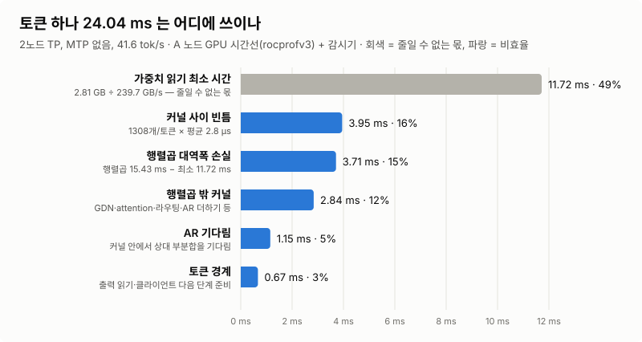

# 2노드 엔진 비효율 전수 조사 (2026-11-08)

토큰 하나를 만드는 데 드는 시간을 GPU 커널 기록(rocprofv3)과 추론 감시기(inferwatch) 기록으로 끝까지 나눠, 어디서 시간이 새는지 모두 적었다.
대상은 [README](../README.md) 의 2노드 TP 엔진(Qwen3.8-Flash-Next H5, HP ZBook Ultra G1a 두 대, USB4 RDMA)이고, 기준 빌드는 엔진 `4a4a7bd`(llama.cpp 패치 포함)다.



## 요약

- **지금:** MTP 없이 41.6 tok/s, 토큰당 24.04 ms. 노드 하나가 토큰마다 가중치 2.81 GB 를 읽으므로(행렬곱 기준), 메모리 대역폭 239.7 GB/s 를
  다 쓰면 11.72 ms 면 된다. **나머지 12.3 ms(51%)가 비효율이다.**
- 그 12.3 ms 는 다섯 가지로 나뉜다(큰 순):
  1. **커널 사이 빈틈 3.95 ms(16%)** — 토큰당 커널 1308개, 커널 하나 띄울 때마다 평균 2.8 µs 의 빈 시간.
  2. **행렬곱이 최고 대역폭에 못 미친 몫 3.71 ms(15%)** — 큰 행렬은 200–231 GB/s 인데, 작은 행렬(MoE·hyper-connection·shared expert·라우터)이 67–184 GB/s.
  3. **행렬곱 밖 커널 2.84 ms(12%)** — GDN(선형 attention)·attention·indexer·라우팅·AR 더하기 등 작은 커널 수백 개.
  4. **AR 기다림 1.15 ms(5%)** — 토큰당 all-reduce 96번, 한 번에 한 방향 ≈18 µs 의 전송 고정 비용과 두 노드 계산 차이.
  5. **토큰 경계 0.67 ms(3%)** — 출력을 클라이언트로 읽고 다음 단계를 발행하는 동안 GPU 가 쉼.
- 구조적인 것 하나: **가중치의 34%(946 MB/토큰)는 두 노드가 똑같이 읽는다**(hyper-connection, 라우터, shared expert). TP 로 나누지 않은 텐서다.
- **85% 목표(72 tok/s, 토큰당 13.9 ms)는 빈틈·작은 커널·AR·경계를 거의 다 없애고 행렬곱 평균이 ≥202 GB/s 일 때만 닿는다.**
  지금처럼 커널을 하나씩 띄우는 방식으로는 닿지 않는다 — 구간 커널(megakernel, [설계](DESIGN_megakernel.md))이 필요하다(§4).
- MTP(56.0 tok/s)는 주기 51 ms 에 2.88 토큰: 4토큰 검증 ≈41 ms(80%) + 초안 3번 ≈6 ms(그동안 B GPU 쉼). 검증은 토큰마다 다른 전문가를 읽어 MoE
  가중치 읽기가 토큰 수에 비례해 는다(추론, §3).

표시: **사실** = 기록에서 직접 잰 값, **추론** = 기록과 코드에서 끌어낸 해석, **가설** = 아직 확인 못 한 것.

## 1. 측정과 자료

| 자료 | 내용 | 위치 |
|---|---|---|
| 커널 기록 | A 서버를 rocprofv3 아래에서 decode 64토큰(llama-bench 클라이언트, 40.77 tok/s). 마지막 60토큰을 씀 | `runs/prof2node-big-1108-1108-222131/a_kernel_trace.csv`(저장소 밖, 33 MB) |
| 시간 장부 | 위 기록을 토큰(출력층 행렬곱 끝 → 다음 출력층 끝)마다 나눔 | [`fixcost/bigpicture-1108/budget.py`](../fixcost/bigpicture-1108/budget.py) → [`budget-A.md`](../fixcost/bigpicture-1108/budget-A.md) |
| 감시기, none | llama-server, 프롬프트 6개 × 256 토큰, 기록 켬 | 세션 `20261108-214347`, 영수증 [`watch-receipt-20261108-214347.md`](../fixcost/boundary-1108/watch-receipt-20261108-214347.md) |
| 감시기, MTP | 같은 조건, 초안 3토큰 | 세션 `20261108-221511`, 영수증 [`watch-receipt-20261108-221511.md`](../fixcost/boundary-1108/watch-receipt-20261108-221511.md) |
| 토큰 경계 | 클라이언트·서버 기록 링을 풀어 경계를 단계별로 | [`fixcost/boundary-1108/cchain.py`](../fixcost/boundary-1108/cchain.py), [`sring.py`](../fixcost/boundary-1108/sring.py) |
| MTP 주기 | 클라이언트 기록으로 검증·초안 단계 나누기 | [`tools/bench/mtpcycle.py`](../tools/bench/mtpcycle.py) |
| 속도 | llama-server, 기록 끔, 번갈아 잰 값 | [RESULTS.md](../RESULTS.md) 2026-11-08 절들 |

방법(사실): 커널 사이 빈틈은 앞 커널 끝 → 다음 커널 시작. AR 기다림이 커널 안에 들어 있는 것(상대 부분합을 기다렸다 더하고 rms_norm 하는 커널,
shared expert down 꼬리)은 그 커널 길이의 하위 10%(4.0 µs, 16.8 µs)를 계산 몫으로, 나머지를 기다림으로 나눴다. 행렬곱이 읽는 바이트는 텐서 모양과
양자화 형식에서 계산했다(나뉘는 텐서는 노드당 절반). 프로파일 회는 클라이언트가 llama-bench 라 토큰 경계는 llama-server 감시기 기록으로 따로 쟀다.

## 2. 토큰 하나의 장부 (MTP 없음)

**사실(A 노드 GPU 시간선, 토큰당 23.37 ms, 커널 1308개):**

| 몫 | ms/토큰 | % |
|---|---:|---:|
| 행렬곱(가중치 읽기) | 15.43 | 66 |
| 커널 사이 빈틈 | 3.95 | 17 |
| 행렬곱 밖 커널 | 2.84 | 12 |
| AR 기다림(커널 안) | 1.15 | 5 |
| **GPU 시간선 합** | **23.37** | 100 |
| + 토큰 경계(llama-server 에서 더 드는 몫: 속도 회 24.04 − 23.37) | 0.67 | |
| **속도 회 토큰 시간** | **24.04** | |

**감시기(llama-server, 기록 켬, 단계 25.32 ms)로 본 같은 단계(사실):** GPU 계산 A 19.77 / B 20.03 ms, 다음 부분그래프 발행 전 쉼(출력층 포함) 2.12 / 2.10,
상대 부분합 기다림 2.90 / 2.60(이 사이에도 GPU 가 다음 커널을 돌릴 수 있어 상한), 1 ms 넘는 링크 멈춤 0.06 / 0.12 ms.

### 2.1 커널 사이 빈틈 — 3.95 ms (16%)

- 사실: 빈틈 ≤5 µs 가 토큰당 1292번, 평균 **2.77 µs**, 합 3.57 ms. 5–20 µs 11.7번(0.10 ms), 20–200 µs 4.1번(0.25 ms).
- 추론: gfx1151(ROCm 7.2.1)에서 같은 스트림의 커널 하나가 끝나고 다음이 시작하기까지의 바닥. 커널마다 하는 일이 작아(평균 18 µs) 바닥이 크게 보인다.
- 해 본 것: 값 그대로 묶기로 커널 2720 → 1308개(11-03 ~ 11-05). HIP 그래프 −8.5%(11-04). 구간 커널 1단계(hc down → hc up/pre → 라우터를 상주 블록 하나로)는
  값 그대로지만 56.7 vs 54.5 µs 로 이득 없음(11-06). 측정: 그리드 장벽 0.27–0.65 µs vs 커널 경계 2.2–4 µs.
- 남은 길: 층 하나(또는 AR 구간 하나)를 상주 커널 하나로 — 빈틈을 장벽(≈0.5 µs)으로 바꾸고, 앞 단계가 도는 동안 다음 가중치를 읽기 시작할 수 있다.

### 2.2 행렬곱 대역폭 손실 — 3.71 ms (15%)

사실(행렬곱 묶음, A 노드, 230 GB/s = 이 기계에서 가장 큰 행렬곱(출력층)이 낸 값):

| 행렬곱 묶음 | 회/토큰 | 회당 µs | MB/토큰 | 실효 GB/s | ms/토큰 | 230 GB/s 이면 ms | 손실 ms |
|---|---:|---:|---:|---:|---:|---:|---:|
| shared expert down + 꼬리 (Q5_0, 복제) | 48 | 16.8 | 54 | 67 | 0.81 | 0.23 | +0.57 |
| MoE gate+up (IQ4_XS, 전문가 나뉨) | 48 | 48.5 | 418 | 180 | 2.33 | 1.82 | +0.51 |
| hc up + pre (Q8_0, 복제) | 96 | 20.1 | 334 | 174 | 1.93 | 1.45 | +0.47 |
| MoE down (IQ4_NL, 전문가 나뉨) | 48 | 25.1 | 221 | 184 | 1.20 | 0.96 | +0.24 |
| GDN qkv+gate (Q5_0, 나뉨) | 36 | 69.2 | 519 | 208 | 2.49 | 2.26 | +0.23 |
| 라우터·indexer q (BF16, 복제) | 72 | 14.4 | 189 | 182 | 1.03 | 0.82 | +0.21 |
| shared expert gate+up (Q5_0, 복제) | 48 | 13.5 | 108 | 167 | 0.65 | 0.47 | +0.18 |
| ssm_out (Q5_0, 나뉨) | 36 | 28.2 | 195 | 192 | 1.01 | 0.85 | +0.17 |
| attn_q (Q5_0, 나뉨) | 12 | 53.7 | 130 | 201 | 0.64 | 0.57 | +0.08 |
| attn_output (Q8_0, 나뉨) | 13 | 41.8 | 109 | 200 | 0.54 | 0.47 | +0.07 |
| attn_k/v (Q5_0, 나뉨) | 24 | 4.6 | 11 | 98 | 0.11 | 0.05 | +0.06 |
| hc down (Q6_K, 복제) | 96 | 12.3 | 261 | 221 | 1.18 | 1.13 | +0.05 |
| 출력층 (Q6_K, 나뉨) | 1 | 1129.0 | 261 | 231 | 1.13 | 1.13 | −0.01 |
| 그 밖 작은 행렬곱 | 39 | 9.6 | — | — | 0.38 | — | — |
| **합** | | | **2809** | 182 | **15.43** | **12.21**(239.7 GB/s 면 11.72) | **+3.22**(+3.71) |

- 사실: 호출 하나가 읽는 양이 클수록 대역폭이 높다 — 출력층(261 MB) 231, GDN qkv(14 MB) 208, MoE gate+up(8.7 MB) 180, hc up(3.5 MB) 174, shared expert(1–2 MB) 67–167 GB/s.
- 사실(11-08): MoE gate+up 을 워프당 2·4·8행으로 바꿔도 49.0 µs 그대로(활성값 읽기·레인 빈자리가 한계가 아님). MoE down 은 블록당 4행으로 30.3 → 24.9 µs(채택).
- 추론: 작은 커널은 시작·끝(첫 읽기가 돌아오기까지, 마지막 블록의 꼬리)에 ≈10 µs 를 쓰고, 그 몫이 호출 길이(13–50 µs)에 비해 크다.
  shared expert down 은 꼬리(게이트 dot·sigmoid·routed 출력 더하기)와 AR 을 같이 안고 있어 67 GB/s.
- 남은 길: 다음 커널의 가중치를 앞 커널이 도는 동안 읽기 시작(구간 커널 안에서, 또는 MALL 로 미리 읽기 — AR 기다림 동안 미리 읽기는 11-07 채택, +2.4%).

### 2.3 행렬곱 밖 커널 — 2.84 ms (12%)

| 묶음(사실) | ms/토큰 | 커널/토큰 |
|---|---:|---:|
| 그 밖 작은 커널(복사·곱·더하기·양자화·hc 섞기 등) | 0.66 | 255 |
| GDN(선형 attention) 연산 | 0.62 | 72 |
| attention·indexer(flash attention, rope, top-k 정렬) | 0.51 | 84 |
| 라우팅·MoE 가중합·argmax | 0.37 | 96 |
| AR 받아 더하기 + rms_norm 의 계산 몫 | 0.34 | 87 |
| AR 부분합 내보내기 | 0.33 | 97 |

- 추론: 대부분 수 µs 짜리 지연 바닥 커널이라 DRAM 대역폭을 거의 쓰지 않는다. 시간을 줄이려면 묶어서 개수를 줄이거나(빈틈과 같은 길), 가중치 읽기와 겹쳐야 한다.

### 2.4 AR 기다림 — 1.15 ms (5%)

- 사실: 토큰당 AR 96번(층마다 attention/GDN 출력·MoE 출력), 한 번에 평균 10.4 KB. 한 방향 지연 p10 15.3 / 중앙 18.0 / p99 72–155 µs.
  커널 안에서 실제로 기다린 시간은 토큰당 1.15 ms(AR 한 번에 평균 ≈12 µs).
- 사실: 1 ms 넘는 기다림(단계당 0.16–0.18 ms)의 90% 는 "상대 GPU 가 늦게 끝냄" — B 의 GPU 계산이 A 보다 단계당 ≈0.26 ms 길다. 링크 늦음은 0–2번/세션
  (tbv `rx_wq_poll=2`, 11-08 이후).
- 추론: 남은 기다림은 (1) 전송 고정 비용(post → 상대 받기 스레드 → 플래그 ≈15 µs, 바이트와 거의 무관 — 16비트 AR 로 바이트를 반으로 줄여도 이득 ≈0, 11-08)과
  (2) 두 노드의 계산 차이.
- 남은 길: tbv 받기 지연(드라이버, sudo 필요), AR 사이 계산량을 두 노드가 같게(B 가 더 느린 이유 조사).

### 2.5 토큰 경계 — 0.67 ms (3%)

- 사실(서버 기록): 마지막 AR 도착 → argmax 응답 1.42 ms(출력층 1.13 ms + 꼬리 0.28 ms), argmax 응답 → 다음 단계 첫 그래프 받음 ≈380 µs.
- 사실(클라이언트 기록, 0 = argmax 응답 받은 때, 중앙): llama_decode +21 → 그래프 준비 +46 → 입력 설정 +70 → 첫 명령 큐 +150 → 첫 그래프 보냄 **+320 µs**.
  오늘 낮 전에는 +620(B) / +730(A) — 입력 복사 앞 쓸데없는 synchronize 빼기, 작은 명령 한 번에 쓰기, 클라이언트 기다림 돌기로 절반(none +1.6%).
- 남은 것: 디스패처가 명령마다 ≈13 µs(원인 못 찾음 — 보내기 버퍼 수는 아님), CPU 의 임베딩 부분그래프(Hadamard 회전·ple) ≈35 µs,
  토큰만 들어오는 디코드에도 남아 있는 벡터·혼합 입력 경로(10 KB 입력 2–3개). 다 줄여도 ≈0.5% 안쪽(추론).
- 해 본 것(안 됨): 명령을 모두 묶어 보내기 −5.7%(서버가 커널을 깊게 앞서 넣어 GPU 계산 +0.8 ms), 입력만 묶기·보내기 버퍼 늘리기 ±0.

### 2.6 구조: 두 노드가 같이 읽는 가중치 — 946 MB/토큰 (34%)

| 텐서(사실) | MB/토큰 | 이유 |
|---|---:|---|
| hc up + pre (Q8_0) | 334 | hyper-connection 섞기 — 층마다 두 번, 출력이 다음 단계 전체에 필요 |
| hc down (Q6_K) | 261 | 같은 이유 |
| 라우터·indexer q (BF16) | 189 | 라우터는 모든 전문가 점수가 필요, indexer 는 KV 선택 |
| shared expert gate+up / down (Q5_0) | 162 | 작아서 나누지 않음 |

- 추론: 이 텐서를 나누면 노드당 읽기가 2.81 → ≈2.34 GB 로 줄어 같은 효율에서 토큰 시간이 ≈−16%. 대신 AR(또는 all-gather)이 늘어 §2.4 의 고정 비용이 붙는다.
  나누는 쪽이 이기는지는 텐서마다 따로 재야 한다(가설).

## 3. MTP(추측 디코딩) 주기

- 사실(감시기 세션 `20261108-221511`, `mtpcycle.py`): 생성 1407 토큰에 ≈488 주기, **주기당 2.88 토큰**(채택률 0.64). 단계 순서 `VV ddd`(검증, 따라잡기, 초안 3번).
  검증(4토큰, 두 노드) 시작 → 결과 중앙 **38.9–41 ms**, 초안(A GPU, 클라이언트 안) 한 번 **1.93 ms**. 속도 56.0 tok/s → 주기 ≈51 ms.
- 사실: 감시기 단계당 GPU 쉼(다음 부분그래프 발행 전) A 2.24 / B 2.18 ms(단계의 19–20%) — 초안을 만드는 동안 B GPU 는 할 일이 없다(주기의 ≈12%).
- 추론: 4토큰 검증은 1토큰 단계(24 ms)의 1.7배. 전문가 아닌 가중치(≈2.17 GB/노드)는 토큰 수와 상관없이 한 번 읽지만, 토큰마다 다른 전문가 10개를
  고르므로(512개 중) 4토큰이면 서로 다른 전문가 ≈39개 → MoE 가중치 읽기가 ≈3.9배(0.64 → ≈2.49 GB). 검증 한 번 ≈4.7 GB 를 41 ms 에 읽어
  ≈115 GB/s(none 의 117 GB/s 와 비슷). 전문가 수 추정은 라우팅이 토큰마다 독립이라는 가정(가설) — 실제 겹침은 재 보지 않았다.
- 남은 길: 초안 동안 B 를 쓰기(예: 다음 검증의 앞부분을 미리), 검증 토큰 수를 채택률에 맞추기, 전문가가 겹치는 토큰을 묶는 순서.

## 4. 85% 목표까지

사용자 지표: 노드당 2.83 GB/토큰 × tok/s ÷ 239.7 GB/s. 85% = 72 tok/s = 토큰당 13.9 ms. 아래는 비효율을 차례로 0 으로 만들 때의 상한(추론, 계산만):

| 단계 | 토큰 ms | tok/s | 대역폭 % |
|---|---:|---:|---:|
| 지금 | 24.04 | 41.6 | 49 |
| 토큰 경계·AR 기다림 0 | 22.22 | 45.0 | 53 |
| + 커널 사이 빈틈 0 | 18.27 | 54.7 | 65 |
| + 행렬곱 밖 커널을 가중치 읽기 뒤로 숨김 | 15.43 | 64.8 | 77 |
| + 행렬곱 평균 202 GB/s(지금 182) | 13.9 | 72 | **85** |
| + 행렬곱 230 GB/s | 12.21 | 81.9 | 97 |

- 빈틈·작은 커널·AR·경계를 거의 다 없애야 77% 이고, 85% 는 행렬곱 평균도 182 → 202 GB/s 로 올라가야 한다. 커널을 하나씩 띄우는 지금 방식으로는
  빈틈(3.95 ms)과 작은 커널의 시작·끝을 없앨 수 없다 → 구간 커널(상주 블록, 단계 사이 장벽, 다음 가중치 미리 읽기)이 필요하다.
- 복제 가중치를 나누면(§2.6) 같은 지표에서 ≈16% 를 더 얻을 수 있다 — 85% 의 대안 경로.

## 5. 이미 해 본 것

| 시도 | 결과 | 날짜 |
|---|---|---|
| 값 그대로 커널 묶기(hc 블록, GLU q8, shared expert 꼬리, GDN 게이트, AR 더하기를 다음 커널 안으로 등) | 커널 2720 → 1308; 11-05 에 묶기 스위치 10개 끔/켬 비교 +5.4% | 11-03 ~ 11-05 |
| HIP 그래프 | −8.5% | 11-04 |
| AR 을 스트림 안에서(ZC=3) + 앞서기 2 | none +6%, MTP +7% | 11-06 |
| AR 기다리는 동안 다음 가중치 MALL 로 미리 읽기 | none +2.4% | 11-07 |
| Thunderbolt 인터럽트 CPU 피하기, tbv 받기 작업 높은 우선순위·묶이지 않은 큐 | 링크 늦음 거의 0, +1–2% | 11-07 ~ 11-08 |
| MoE down 블록당 4행 | +1.7% | 11-08 |
| 16비트 AR, split-K, MoE gate+up 워프당 여러 행, hc up 4행 한 고리, Q5_0 블록당 여러 행 | 이득 없음 또는 느려짐 | 11-07 ~ 11-08 |
| 구간 커널 1단계(MoE 앞부분 상주 커널) | 값 그대로, 이득 없음(협조 launch 는 −2.5%) | 11-06 |
| 토큰 경계: 입력 복사 기다림 빼기 + 한 번에 쓰기 + 클라이언트 돌기 | none +1.6%, MTP +1.1–1.7% | 11-08 |
| 명령 모두 묶어 보내기 | −5.7%(깊은 GPU 큐) | 11-03, 11-08 |

자세한 수치는 [RESULTS.md](../RESULTS.md), 스위치는 [SWITCHES.md](SWITCHES.md).

## 6. 다음 실험 제안 (큰 순)

1. **구간 커널 2단계** — MoE 블록(라우터 → gate+up → down → shared expert → AR) 을 상주 커널 하나로. 겨누는 몫: 빈틈 + 작은 행렬곱 시작·끝(합 ≈2–3 ms/토큰).
   1단계에서 안 됐던 이유(커널 하나가 세 커널보다 길었음)를 먼저 풀어야 한다.
2. **AR 고정 비용** — tbv 받기 경로 지연(≈15 µs 바닥) 줄이기(드라이버, sudo), B 가 단계당 0.26 ms 느린 이유.
3. **복제 가중치 나누기** — hc up/down 부터, AR 이 하나 늘 때의 비용과 비교.
4. **MTP** — 초안 동안 노는 B, 검증의 전문가 겹침 측정.

## 부록: 다시 재는 법

```bash
# 커널 기록(A 서버, 두 노드에 서버가 없을 때)
bash tools/bench/prof2node.sh big 64
python3 -I fixcost/bigpicture-1108/budget.py runs/prof2node-big-*/a_kernel_trace.csv
# 감시기 회(속도 회 다음에 기록 켠 회를 하나씩) — tools/bench/node-ab.sh 기본 WATCH=1
OUTDIR=mytest RUNS="none:def mtp:def" bash tools/bench/node-ab.sh
# 토큰 경계, MTP 주기
python3 -I fixcost/boundary-1108/cchain.py runs/watch/<세션>
python3 -I fixcost/boundary-1108/sring.py runs/watch/<세션> a
python3 -I tools/bench/mtpcycle.py runs/watch/<세션>/client.ring
# 그림
python3 -I fixcost/bigpicture-1108/mkchart.py docs/inefficiency-1108/token-budget.svg
```
